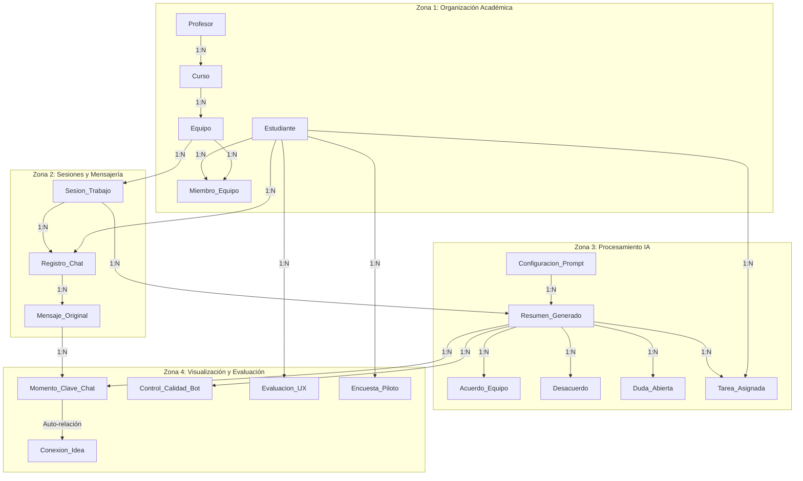

# Documento Base de SICOCO (Sintetizador de Co-creación Colaborativa)

**Contexto Académico e Institucional:**
El proyecto **SICOCO** nace como una iniciativa de los estudiantes de la **Licenciatura en Informática con énfasis en Medios Audiovisuales** de la **Universidad de Córdoba** (Montería, Colombia), bajo la dirección del docente **Alexander Enrique Toscano Ricardo**. Su ciclo de vida abarca dos periodos académicos fundamentales:
- **8vo Semestre (2026-1):** Asignatura *Diseño y Desarrollo de Software Educativo I* (Código 203447), centrada en el diagnóstico de necesidades, diseño pedagógico, fundamentación metodológica (**MODESEC**), historias de usuario y modelado de datos conceptual/relacional.
- **9no Semestre (2026-2):** Asignatura *Diseño y Desarrollo de Software Educativo II* (Código 203453), enfocada en la validación técnica formal (**Informe U1-01**), el refinamiento del Modelo Entidad-Relación a la Versión 2 (**V2**) y la construcción física del backend empresarial (**`sicoco-framework`**) utilizando **NestJS 12**, **TypeScript**, **MongoDB/Mongoose**, **OpenAPI Swagger** y **Vitest**.

**Equipo de Desarrollo (SICOCO Dev Team):**
- José Daniel Durango Caballero
- Jefersson Ramírez Oviedo
- Jesús Daniel Ruiz Román
- Jeyson David López Gorrostola

---

## Descripción del Proyecto

SICOCO es una herramienta digital de procesamiento de texto basada en **Inteligencia Artificial** diseñada para capturar, analizar, clasificar y sintetizar transcripciones de chats y foros de trabajo grupal (WhatsApp Web, Discord, Teams). Su propósito trasciende el resumen convencional: actúa como un recurso pedagógico metacognitivo que le permite a los estudiantes visualizar cómo colaboran, identificar responsabilidades individuales y fomentar el aprendizaje en equipo bajo el modelo por competencias.

---

## ¿Por qué Co-Creación?

SICOCO se define fundamentalmente como una plataforma de **co-creación** y no meramente de **creación** (ya sea individual o grupal tradicional). Mientras que las herramientas convencionales de creación se limitan a proporcionar un espacio para redactar un producto final, SICOCO interviene de manera activa y pedagógica en el proceso constructivo que da origen a dicho producto.

Bajo el marco metodológico **MODESEC**, el software se cataloga como una herramienta de co-creación por las siguientes razones esenciales:

1. **Trazabilidad y Evolución de las Ideas (El Tejido Colectivo):** En una herramienta de creación simple, el resultado borra los debates intermedios. SICOCO, en cambio, mapea la evolución del pensamiento grupal. Mediante el *Mapeo de Co-Creación* (reflejado en el modelo relacional V2 con la auto-relación `Conexion_Idea`), el sistema registra cronológicamente cómo las ideas iniciales de un integrante se conectan, complementan o transforman con los aportes de sus compañeros.
2. **Foco en el Diálogo y la Negociación Pedagógica:** La co-creación requiere diálogo y confrontación constructiva de saberes. SICOCO procesa y categoriza explícitamente no solo los **Acuerdos**, sino también los **Desacuerdos** y las **Dudas abiertas**. Esto visibiliza la negociación de significados del grupo, demostrando que el conocimiento educativo es el resultado de un consenso dinámico y no de una simple asignación monótona de tareas.
3. **El Rol Mediador de la Inteligencia Artificial:** En este sistema, la IA no crea el contenido por el estudiante, sino que actúa como un espejo metacognitivo que le devuelve al equipo la estructura lógica de su propia discusión. Al clasificar los aportes, la IA facilita que los co-creadores (estudiantes y docentes) reflexionen sobre el curso de su colaboración, tomen control de su propio aprendizaje y afinen su trabajo.
4. **Visibilización de la Agencia y la Corresponsabilidad:** La co-creación pone en valor el aporte singular de cada individuo al logro común. A través del registro de alias y autores integrados en el dashboard y las líneas de tiempo, SICOCO valida la autoría intelectual de cada estudiante, demostrando cómo la suma interactiva de los aportes de todos define el éxito del proyecto.

---

## El Problema

El entorno de aprendizaje actual exige que los estudiantes trabajen en equipo utilizando herramientas asíncronas y chats de mensajería (WhatsApp, Discord, Teams). Esto genera una **sobrecarga de información**, provocando que valiosas ideas, debates importantes y acuerdos consensuados se pierdan o se olviden en medio de extensas cadenas de mensajes. SICOCO resuelve este problema identificando:

1. **Qué se dice:** Acuerdos consolidados y consensos tomados.
2. **Quién dio cada idea:** Reconocimiento de la autoría para validar participaciones.
3. **Cómo el grupo debatió:** Mapeo cronológico de discrepancias, dudas y resoluciones.

---

## La Solución Propuesta (Arquitectura del MVP)

Desarrollar un Producto Mínimo Viable (MVP) compuesto por dos capas complementarias:
1. **Frontend / Extensión de Navegador Chromium:** Permite capturar directamente del DOM de plataformas de mensajería en la web (WhatsApp Web, Discord, Teams) o cargar archivos de historial exportados (.txt, .csv, .json), mostrando un **Dashboard** interactivo con líneas de tiempo y tableros por categorías.
2. **Backend Empresarial y API REST (`sicoco-framework`):** Servidor modular construido sobre **NestJS 12**, **TypeScript** y **MongoDB/Mongoose**, encargado de la ingesta asíncrona de transcripciones, orquestación de prompts con LLMs (Google Gemini / OpenAI), almacenamiento estructurado de entidades y exposición de servicios documentados con Swagger OpenAPI.

---

## Usuarios Objetivo

- **Estudiantes Universitarios y Escolares:** Principales beneficiarios que buscan optimizar su tiempo, coordinar asignaciones y no perder el hilo de sus proyectos grupales.
- **Docentes / Evaluadores:** Supervisores que requieren observar objetivamente los niveles reales de participación, validar consensos y calificar la colaboración fuera del aula.
- **Equipos de Trabajo General:** Grupos académicos o interdisciplinarios que necesitan registrar y auditar decisiones de proyectos remotos.

---

## Objetivos

### Objetivo General
Desarrollar un Producto Mínimo Viable de la herramienta SICOCO que utilice Inteligencia Artificial para resumir y analizar chats colaborativos, estructurando la información según la metodología MODESEC para fortalecer las competencias de trabajo en equipo en estudiantes de educación superior.

### Objetivos Específicos
1. **Clasificar el contenido** extraído en cuatro ejes fundamentales: Acuerdos, Desacuerdos, Tareas (To-Do) y Dudas sin resolver.
2. **Generar un reporte visual y amigable** (Línea de tiempo y Tableros) que permita al estudiante comprender de un solo vistazo el estatus de su proyecto.
3. **Identificar la autoría de las ideas** para destacar el aporte individual al logro colectivo.
4. **Construir e integrar un backend modular** (NestJS + MongoDB) con capacidades asíncronas para el procesamiento confiable de LLMs sin caídas por timeout.
5. **Validar la utilidad educativa** de la herramienta mediante pruebas de campo (precisión técnica, usabilidad y valor formativo) en cursos de la Universidad de Córdoba.

---

## Fundamentación Metodológica Integral (Modelo MODESEC)

La fundamentación metodológica del proyecto SICOCO se basa en el modelo **MODESEC** (Modelo de Organización de Estrategias para el Desarrollo de Software Educativo por Competencias). Este ecosistema pedagógico orienta el software hacia la generación de evidencias observables de aprendizaje:

1. **La Primacía del Aprendizaje:** La tecnología es el medio que hace tangible el progreso intelectual del equipo y transparenta las discusiones grupales.
2. **Principios Orientadores:** Desarrollo de competencias colaborativas, pensamiento crítico y autorregulación del aprendizaje.
3. **Framework de Ingeniería:** Segmentación del ciclo de vida en fases interconectadas:
   - **Dominio Técnico-Académico:** Gestión de identidades, roles (docente/estudiante), cursos y equipos.
   - **Dominio del Procesamiento Pedagógico:** Núcleo de IA donde los prompts aplican filtros metodológicos para estructurar los cuatro pilares.
   - **Dominio de Visualización Educativa:** Diseño de la GUI para presentar mapas de co-creación y cronología de hitos.
   - **Dominio de Evaluación:** Instrumentos de auditoría técnica y pedagógica (calidad de síntesis, UX y encuestas formativas).

---

## Fases del Proyecto (Enfoque MODESEC)

### Fase 1: Diagnóstico (Análisis de Competencias) — *Completado*
Definición de competencias a fortalecer y diagnóstico de la sobrecarga de información en la comunicación asíncrona. Meta central: *“Resumir y analizar lo que el grupo habla al trabajar en equipo, sirviendo como una guía de apoyo pedagógico”*.

### Fase 2: Diseño Pedagógico y Planificación — *Completado*
Estructuración de los cuatro ejes de salida:
1. **Acuerdos:** Puntos de consenso y decisiones tomadas.
2. **Desacuerdos u objeciones:** Debates y posturas encontradas.
3. **Dudas sin resolver:** Interrogantes pendientes de resolución.
4. **Tareas por hacer (To-Do):** Compromisos, responsables y fechas límites.
Definición de la línea de tiempo de co-creación, levantamiento de requerimientos con el Arquitecto de Datos y especificación de historias de usuario.

### Fase 3: Diseño Computacional y Técnico — *Completado (V2)*
Plan arquitectónico del MVP. Incluye la formalización del **Modelo Entidad-Relación V2** (19 entidades normalizadas, auto-relación `Conexion_Idea`, `Evaluacion_UX` y atributos de privacidad) y la decisión de arquitectura híbrida de persistencia (MongoDB para mensajería y esquemas relacionales para negocio).

### Fase 4: Producción y Desarrollo — *En Desarrollo Activo*
Construcción física del software:
- **Backend Framework (`sicoco-framework`):** Implementado en **NestJS 12** y **TypeScript**, con esquemas de **MongoDB/Mongoose** para Usuarios y Cursos, endpoints REST, documentación Swagger OpenAPI en `/api`, y suite de pruebas con **Vitest**.
- **Próximos Componentes:** Módulo de ingesta de transcripciones, orquestador de prompts para la API de Gemini (con cola de trabajos asíncrona) y extensión de navegador Chromium.

### Fase 5: Evaluación (Pruebas de Campo) — *Planeado*
Validación del sistema mediante tres pruebas controladas:
1. **Prueba de Precisión Técnica:** Fidelidad del resumen y detección de alucinaciones.
2. **Revisión de Usabilidad (UX):** Claridad visual y navegación por pestañas en el Dashboard.
3. **Prueba de Utilidad Educativa:** Encuesta de percepción sobre la mejora en la comprensión y el trabajo en equipo.

### Fase 6: Implementación y Seguimiento — *Planeado*
Programa piloto en cursos reales de la Universidad de Córdoba por tres semanas consecutivas y mantenimiento evolutivo.

---

## Validación Técnica del Diseño: Semestre IX (Informe U1-01)

Al iniciar el 9no semestre en la materia *Diseño y Desarrollo de Software Educativo II*, el equipo realizó una auditoría exhaustiva (**Informe U1-01**) sobre el diseño heredado del semestre anterior, con coevaluación del equipo **EDUQUEST**:

### 1. Hallazgos sobre el Modelo de Datos
- **Entidad `Control_Calidad_Bot` huérfana:** Carecía de clave foránea hacia el evaluador. Se solucionó incorporando `ID_Profesor` (FK) para certificar la auditoría docente (descartando la evaluación comunitaria anónima por falta de rigor académico).
- **Desconexión entre Alias de chat y Estudiante real:** Guardar apodos libres impedía asignar tareas a usuarios matriculados. Se formuló el catálogo de homologación `Alias_Estudiante` (descartando obligar al estudiante a renombrarse en WhatsApp por ser invasivo con su privacidad).
- **Encuestas desvinculadas de la sesión:** Se vinculó `ID_Sesion` para contextualizar la evaluación de usabilidad a reuniones específicas.
- **Ausencia de longitudes en tipos de datos:** Se definieron restricciones de tamaño para evitar desbordamientos de memoria en la base de datos.

### 2. Hallazgos sobre Servicios y Backend
- **Falla por Procesamiento Sincrónico de IA (Timeout):** Transcripciones de cientos de mensajes tardan más de 20 segundos en procesarse con LLMs, excediendo el límite de conexión HTTP. Se diseñó un flujo **asíncrono** (`POST` -> `Job_ID` -> `Polling`/WebSockets), descartando elevar los timeouts del servidor a 10 minutos porque agotaría los hilos de conexión.
- **Falta de Actualizador Automático de Tareas:** Se requirió un servicio de fondo (*Cron Job*) para marcar tareas vencidas según su `Fecha_Limite`.
- **Contrato de Ingesta del Scraper Web:** Definición formal de esquemas JSON para recibir los nodos del DOM desde la extensión.

---

## Arquitectura de Datos: Modelo Relacional V2

El modelo relacional optimizado cuenta con **19 entidades** organizadas en 4 zonas clave (véase documento `15_entity_relationship_model_v2.md` y diagrama `SICOCO v2.png`):

### Principales Mejoras de la Versión 2:
- **`Conexion_Idea`:** Auto-relación reflexiva en `Momento_Clave_Chat` (`ID_Idea_Base` -> `ID_Aporte_Extra`) para trazar la co-creación de ideas.
- **`Evaluacion_UX`:** Tabla para evaluar usabilidad (`Claridad_Visual`, `Separacion_Vista_Tareas`, `Sugerencias_Extra`).
- **Seguridad:** Banderas `Es_Confidencial` en `Registro_Chat` y `Requiere_Aprobacion_Profesor` en `Equipo`.
- **Conexión de Prompts:** Clave foránea formal `ID_Configuracion` en `Resumen_Generado` vinculada a `Configuracion_Prompt`.

---

## Arquitectura del Backend y API REST (`sicoco-framework`)

Para materializar la persistencia y la lógica del sistema, se construyó el backend en el repositorio `sicoco-framework` estructurado en **6 módulos operativos** que abarcan las cuatro zonas del modelo MODESEC:

1. **Stack Tecnológico:** NestJS 12.0.1, TypeScript 6.0, Node.js 24, MongoDB 9 / Mongoose 9.11.4, Vite / Vitest 4.1.2, Swagger OpenAPI 12.1.0, `@nestjs/observe`, oxlint, prettier.
2. **Punto de Entrada (`main.ts`):** Inicialización modular con telemetría e interfaz interactiva de Swagger OpenAPI desplegada en `/api` con tags para los 6 módulos.
3. **Módulo de Usuarios (`UsersModule` - `/users`):**
   - Esquema Mongoose `User` con campos `name`, `email` (único y obligatorio), `age` y timestamps automáticos.
   - Endpoints REST: `POST /users`, `GET /users`, `GET /users/:id`, `PATCH /users/:id`, `DELETE /users/:id`.
   - DTOs tipados (`CreateUserDto`, `UpdateUserDto`).
4. **Módulo de Cursos (`CoursesModule` - `/courses`):**
   - Esquema Mongoose `Course` (colección `'courses'`) con `code` (único), `name`, `academicSemester`, `instructor`, `description`, `isActive` y timestamps.
   - Endpoints REST: `POST /courses`, `GET /courses`, `GET /courses/:id`, `PATCH /courses/:id`, `DELETE /courses/:id`.
   - DTOs tipados (`CreateCourseDto`, `UpdateCourseDto`).
5. **Módulo de Equipos Colaborativos (`TeamsModule` - `/teams`):**
   - Esquema Mongoose `Team` con `name`, `courseId`, `requiresTeacherApproval`, subdocumentos embebidos `members` (`studentId`, `studentName`, `role`, `joinedAt`) y estado `isActive`.
   - Endpoints REST: `POST /teams`, `GET /teams`, `GET /teams/:id`, `PATCH /teams/:id`, `POST /teams/:id/members`, `DELETE /teams/:id/members/:studentId`, `DELETE /teams/:id`.
6. **Módulo de Sesiones de Trabajo (`SessionsModule` - `/sessions`):**
   - Esquema Mongoose `Session` con `title`, `generalObjective`, `teamId`, `meetingDate`, `platformOrigin` (whatsapp, discord, teams, meet, slack, other), `estimatedDurationMinutes` y `status`.
   - Endpoints REST: `POST /sessions`, `GET /sessions`, `GET /sessions/:id`, `PATCH /sessions/:id`, `DELETE /sessions/:id`.
7. **Módulo de Ingesta de Transcripciones (`TranscriptsModule` - `/transcripts`):**
   - Esquema Mongoose `Transcript` con `sessionId`, `sourcePlatform`, `format`, `dataSize`, bandera de seguridad `isConfidential` y subdocumentos jerárquicos `ChatMessage` (`senderName`, `senderId`, `senderAlias`, `timestamp`, `content`, `messageOrder`, `platformMetadata`).
   - Endpoints REST: `POST /transcripts`, `GET /transcripts`, `GET /transcripts/:id`, `POST /transcripts/:id/messages` (ingesta masiva desde scraper del navegador), `PATCH /transcripts/:id`, `DELETE /transcripts/:id`.
8. **Módulo de Síntesis MODESEC y Co-creación (`SummariesModule` - `/summaries`):**
   - Esquema Mongoose `Summary` con los cuatro pilares pedagógicos de MODESEC:
     - `agreements`: Consensos y acuerdos con nivel de consenso y participantes.
     - `disagreements`: Desacuerdos pedagógicos y posturas opuestas.
     - `doubts`: Dudas abiertas clasificadas por categoría y urgencia.
     - `tasks`: Tareas To-Do asignadas con responsables, fechas límite y prioridades.
     - `timeline`: Momentos clave con soporte para la relación reflexiva `Conexion_Idea` (`inspiredByMomentId`).
   - Flujo Asíncrono Anti-Timeout (Mitigación U1-01): `POST /summaries/generate` genera un `jobId` único UUID y responde inmediatamente `202 Accepted`, mientras que `GET /summaries/job/:jobId` permite sondeo (*polling*) hasta completar la inferencia con el LLM.
   - Endpoints CRUD: `POST /summaries`, `GET /summaries`, `GET /summaries/:id`, `PATCH /summaries/:id`, `DELETE /summaries/:id`.
9. **Infraestructura de Calidad y Pruebas Automatizadas:**
   - Adopción de **Vitest** en lugar de Jest, ejecutando 13 suites de pruebas unitarias (`*.spec.ts`) para todos los módulos y controladores con 100% de aprobación.
   - Pruebas de integración E2E configuradas con `supertest` en `test/app.e2e-spec.ts`.
   - Linter de alta velocidad `oxlint` y formateo estandarizado con Prettier.

---

## Entrevista Técnica: Arquitectura de Datos de SICOCO (20 Preguntas)

**Rol:** Arquitecto de Datos Senior  
**Objetivo:** Identificar los requerimientos para el modelado de la base de datos relacional del proyecto SICOCO.

### Bloque 1: Usuarios, Roles y Organización Académica
1. **¿Qué datos personales y académicos registrar sobre cada estudiante?** Entidad `Estudiante`: `ID_Estudiante`, `Numero_Identidad_Matricula`, `Nombres`, `Apellidos`, `Correo_Institucional`, `Contraseña_Encriptada`, `Semestre_Actual`, `Programa_Academico`, `Fecha_Registro`.
2. **¿Existen otros tipos de usuarios?** Entidad `Profesor`: `ID_Profesor`, `Numero_Empleado`, `Nombres`, `Apellidos`, `Correo_Institucional`, `Departamento`, `Permiso_Sistema`.
3. **¿Cómo organizar académicamente a los estudiantes?** Entidad `Curso`: `ID_Curso`, `Codigo_Materia`, `Nombre_Materia`, `Semestre_Academico`, `ID_Profesor_Responsable`.
4. **¿Cómo estructurar los equipos de trabajo?** Entidad `Equipo`: `ID_Equipo`, `Nombre_Equipo`, `ID_Curso`, `Fecha_Creacion`, `Requiere_Aprobacion_Profesor`.
5. **¿Cómo gestionar a los integrantes de los equipos?** Entidad intermedia `Miembro_Equipo`: `ID_Relacion`, `ID_Estudiante`, `ID_Equipo`, `Rol_En_Equipo`, `Fecha_Union`.

### Bloque 2: Entradas de Datos (Chats y Sesiones)
6. **¿Qué guardar de la reunión o sesión?** Entidad `Sesion_Trabajo`: `ID_Sesion`, `ID_Equipo`, `Fecha_Reunion`, `Objetivo_General`, `Plataforma_Origen`, `Duracion_Estimada`.
7. **¿Qué guardar del ingreso del chat?** Entidad `Registro_Chat`: `ID_Registro`, `ID_Sesion`, `Origen_Metadata`, `Formato_Entrada`, `Tamaño_Datos`, `ID_Estudiante_Ingresa`, `Es_Confidencial`, `Created_At`.
8. **¿Guardar cada mensaje individual?** Entidad `Mensaje_Original`: `ID_Mensaje`, `ID_Registro`, `Alias_Remitente`, `Cuerpo_Del_Mensaje`, `Fecha_Hora_Mensaje`.

### Bloque 3: Procesamiento de IA (Prompts y Motor)
9. **¿Cómo guardar las instrucciones maestras (prompts)?** Entidad `Configuracion_Prompt`: `ID_Configuracion`, `Nombre_Estilo`, `Texto_Instruccion_IA`, `Estado_Activo`.
10. **¿Qué detalles guardar del resumen final?** Entidad `Resumen_Generado`: `ID_Resumen`, `ID_Sesion`, `ID_Configuracion`, `Texto_Final_Plano`, `Modelo_IA_Usado`, `Consumo_Tokens`, `Fecha_Generacion`, `ID_Editor_Ultimo`, `Updated_At`.

### Bloque 4: Pilares de Información (Salidas IA)
11. **¿Qué compone un "Acuerdo"?** Entidad `Acuerdo_Equipo`: `ID_Acuerdo`, `ID_Resumen`, `Descripcion_Solucion`, `Nivel_Importancia`, `Alias_Quien_Propone`.
12. **¿Qué compone un "Desacuerdo"?** Entidad `Desacuerdo`: `ID_Desacuerdo`, `ID_Resumen`, `Tema_Debate`, `Descripcion_Oposicion`, `Estado_Resolucion`.
13. **¿Qué compone una "Duda sin Resolver"?** Entidad `Duda_Abierta`: `ID_Duda`, `ID_Resumen`, `Pregunta_Principal`, `Relacionado_Con_Tema`.
14. **¿Qué compone una "Tarea"?** Entidad `Tarea_Asignada`: `ID_Tarea`, `ID_Resumen`, `Titulo_Actividad`, `ID_Estudiante_Asignado`, `Estatus`, `Fecha_Limite`.

### Bloque 5: Mapeo de Co-Creación (Línea de Tiempo)
15. **¿Cómo estructurar la cronología de ideas?** Entidad `Momento_Clave_Chat`: `ID_Momento`, `ID_Resumen`, `Marca_Tiempo_Aproximada`, `ID_Mensaje_Relacionado`, `Alias_Usuario`, `Evento`.
16. **¿Cómo enlazar aportes interconectados?** Entidad reflexiva `Conexion_Idea`: `ID_Conexion`, `ID_Idea_Base`, `ID_Aporte_Extra`.

### Bloque 6: Evaluación y Pruebas
17. **¿Qué auditar de la calidad del resumen?** Entidad `Control_Calidad_Bot`: `ID_Test`, `ID_Resumen`, `ID_Profesor`, `Cantidad_Falsos_Positivos`, `Calificacion_Fidelidad_Texto`, `Comentario_Tecnico`.
18. **¿Qué guardar de la facilidad de uso (UX)?** Entidad `Evaluacion_UX`: `ID_Eval_UX`, `ID_Estudiante`, `Claridad_Visual`, `Separacion_Vista_Tareas`, `Sugerencias_Extra`.
19. **¿Cómo medir el impacto educativo?** Entidad `Encuesta_Piloto`: `ID_Encuesta`, `ID_Estudiante`, `Mejor_Comprension_Objetivos`, `Nivel_Apoyo_Grupo`, `Fecha_Respuesta`.

### Bloque 7: Escalabilidad, Privacidad y Seguridad
20. **¿Cómo asegurar la infraestructura y privacidad?** Fechas de auditoría obligatorias (`Created_At`, `Updated_At`), marcas de confidencialidad (`Es_Confidencial`), aprobación de equipos (`Requiere_Aprobacion_Profesor`), IDs protegidos y encriptación de claves.

---

## Matriz de Historias de Usuario

La matriz consolidada agrupa 16 historias funcionales con criterios de aceptación en formato Gherkin (véase detalle en `08_user_stories.md`):
- **Zona 1: Usuarios y Organización (PER-01 a PER-04):** Registro académico, vinculación docente a cursos, actualización de credenciales y membresía de equipos.
- **Zona 2: Entradas y Sesiones de Trabajo (SES-01 a SES-04):** Apertura de sesión, carga de historiales, particionado atómico de mensajes y consulta de registros históricos.
- **Zona 3: Motor de IA y Procesamiento (IA-01 a IA-04):** Categorización en acuerdos, dudas y tareas, extracción de compromisos con responsable, detección de interrogantes y conteo de temas frecuentes.
- **Zona 4: Visualización y Línea de Tiempo (GUI-01 a GUI-04):** Visualización de hitos cronológicos, identificación de autores, selección de estilo de resumen y navegación por categorías.
- **Zona 5: Evaluación y Seguridad (EVA-01 a EVA-04):** Calificación docente de fidelidad (1-10), edición manual del resumen, auditoría de cambios y control estricto de acceso por roles.

---

## Catálogo de Documentación del Proyecto SICOCO (Nomenclatura en Inglés)

| N° | Archivo | Fase / Tema | Propósito Principal |
| :---: | :--- | :--- | :--- |
| **00** | **`00_base_document.md`** | General / Maestro | Documento maestro con el contexto institucional, fundamentación MODESEC, modelo relacional V2 y arquitectura de backend. |
| **01** | **`01_diagnosis.md`** | Fase 1: Diagnóstico | Delimitación del problema de sobrecarga informativa y perfiles de usuario. |
| **02** | **`02_pedagogical_design.md`** | Fase 2: Diseño Pedagógico | Estructuración pedagógica de los cuatro ejes de resumen y mapa de co-creación. |
| **03** | **`03_computational_design.md`** | Fase 3: Diseño Computacional | Especificaciones iniciales de arquitectura técnica y viabilidad de MVP. |
| **04** | **`04_production_and_development.md`** | Fase 4: Producción | Directrices para el desarrollo del frontend (extensión) y del backend en NestJS. |
| **05** | **`05_evaluation.md`** | Fase 5: Evaluación | Metodología de validación en campo (precisión, usabilidad y utilidad formativa). |
| **06** | **`06_implementation_and_monitoring.md`** | Fase 6: Implementación | Planificación del programa piloto institucional y mantenimiento evolutivo. |
| **07** | **`07_data_architecture_interview_og.md`** | Requerimientos Originales | Respuestas preliminares sobre el modelado físico de datos de las 19 tablas. |
| **07A** | **`07A_interview_questions.md`** | Requerimientos (Preguntas) | Cuestionario estructurado de 20 preguntas con el Arquitecto de Datos. |
| **07B** | **`07B_interview_answers.md`** | Requerimientos (Respuestas) | Respuestas técnicas estructuradas para el levantamiento de entidades. |
| **08** | **`08_user_stories.md`** | Requisitos Funcionales | Matriz de historias de usuario y criterios de aceptación en 5 zonas. |
| **09** | **`09_methodological_foundation.md`** | Fundamento Pedagógico | Enfoque de co-creación, competencias y taxonomías formativas de MODESEC. |
| **10** | **`10_entity_relationship_model.md`** | Diseño de Base de Datos V1 | Especificación relacional inicial de 19 entidades en código DBML/SQL. |
| **11** | **`11_interview_model_comparison.md`** | Validación de Trazabilidad | Matriz de correspondencia cruzada entre preguntas y modelo relacional. |
| **12** | **`12_technical_development.md`** | Arquitectura Técnica MVP | Especificación técnica de componentes, flujos críticos y seguridad del MVP. |
| **13** | **`13_first_semester_scope.md`** | Cierre Semestre I (8vo) | Hito de cierre del 8vo semestre, certificando la culminación de la fase de solo diseño. |
| **14** | **`14_technical_design_validation.md`** | Validación Técnica U1-01 | Auditoría del diseño heredado, resolución de timeouts en IA y homologación de alias. |
| **15** | **`15_entity_relationship_model_v2.md`** | Modelo Relacional V2 | Esquema integrado V2 con `Conexion_Idea`, `Evaluacion_UX`, prompts y seguridad. |
| **16** | **`16_backend_architecture_and_api.md`** | Arquitectura de Backend | Especificación técnica del backend en `sicoco-framework` (NestJS 12, MongoDB, Swagger, Vitest). |
| **17** | **`17_second_semester_scope.md`** | Cierre y Avances Semestre II (9no) | Síntesis ejecutiva de la evolución del proyecto y transición al prototipo programado. |

---

## Alcance Histórico: Cierre del Primer Semestre (8vo Semestre — Solo Diseño)

Al término del **8vo semestre** (*Diseño y Desarrollo de Software Educativo I*), el proyecto SICOCO alcanzó el **100% de la fase de planificación y fundamentación teórica**:
- Estructuración de las Fases 1, 2 y 3 de MODESEC.
- Cuestionario de requerimientos con 20 preguntas y matriz de trazabilidad.
- Matriz de 16 historias de usuario formalizadas con criterios Gherkin.
- Modelado inicial de la base de datos relacional de 19 tablas en DBDiagram.
- En dicho periodo, **SICOCO no contaba con prototipo ejecutable ni código programado**.

---

## Alcance y Estado Actual: Avances del Segundo Semestre (9no Semestre — Software en Ejecución)

En el **9no semestre** (*Diseño y Desarrollo de Software Educativo II*), el proyecto dio el salto cualitativo hacia la **construcción física del sistema**:
1. **Validación Técnica Aprobada:** Se solventaron las inconsistencias de diseño mediante el informe **U1-01** (mitigación de timeouts mediante procesamiento asíncrono y resolución de alias de estudiantes).
2. **Modelo de Datos V2 Consolidado:** Se integraron `Conexion_Idea`, `Evaluacion_UX`, banderas de confidencialidad y la relación directa con `Configuracion_Prompt`.
3. **Backend Empresarial Programado y Operativo:** En el repositorio `sicoco-framework`, se implementó el servidor base en **NestJS 12** con módulos CRUD tipados para `Users` y `Courses`, conexión a **MongoDB via Mongoose**, interfaz interactiva de **Swagger OpenAPI** en `/api` y suite de pruebas automatizadas con **Vitest**.
4. **Roadmap para Cierre del MVP:** Implementar el módulo de ingesta de chats (`SessionsModule`), la integración con la API de Google Gemini (`AiModule`) y la extensión Chromium para desplegar el Dashboard interactivo ante los cursos piloto de la Universidad de Córdoba.

---

## Recursos Visuales y Anexos

- **Documento Técnico en Formato APA 7 (.docx):** [Technical Document.docx](../Resources/Technical%20Document.docx)
- **Diagrama Entidad-Relación V2 (Dark):** [SICOCO v2.png](../Resources/SICOCO_v2.png)
- **Diagrama Entidad-Relación V2 (Light):** [SICOCO v2 (Light).png](../Resources/SICOCO_v2_Light.png)
- **Código DBML V2:** [diagrama_bd_v2.dbml](../Resources/diagrama_bd_v2.dbml)
- **Documento PDF del Modelo:** [MER - SICOCO.pdf](../Resources/MER%20-%20SICOCO.pdf)
- **Diagrama Inicial (V1):** [DBDiagram.png](../Resources/DBDiagram.png) | [Modelo Relacion - Entidad V2.png](../Resources/Modelo%20Relacion%20-%20Entidad%20V2.png)
