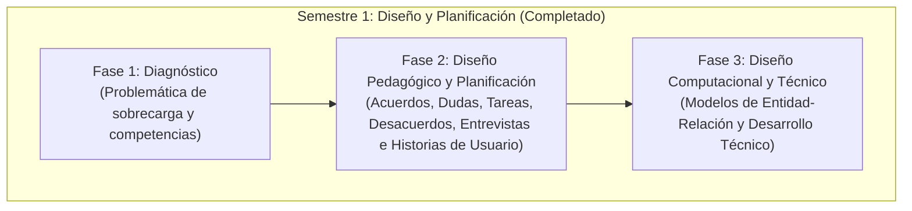

# Guía de Estudio y Presentación de SICOCO (Cierre del Primer Semestre)

## Evolución, Colaboración y Estado del Proyecto (Solo Diseño y Documentación)

Este documento sirve como resumen ejecutivo y guion de estudio para presentar el proyecto **SICOCO** (*Sintetizador de Co-creación Colaborativa*) al cierre del **8vo semestre** (*Diseño y Desarrollo de Software Educativo I*). Explica cómo nació el proyecto, cómo evolucionó gracias al trabajo conjunto entre el equipo de estudiantes y el asistente de IA, y cuál fue el estado y alcance logrados en dicho periodo.

> **Nota de Continuidad:** Para consultar los avances técnicos, la validación U1-01, el modelo V2 y el desarrollo del backend en NestJS alcanzados en el 9no semestre (*Diseño y Desarrollo de Software Educativo II*), consulte el documento [17_second_semester_scope.md](17_second_semester_scope.md).

---

## 1. Cronología y Evolución del Primer Semestre

El proyecto se estructuró siguiendo estrictamente la metodología **MODESEC** (Modelo de Organización de Estrategias para el Desarrollo de Software Educativo por Competencias) para asegurar que la futura herramienta no sea solo técnica, sino que tenga un **propósito pedagógico** que fortalezca el aprendizaje colaborativo.

### Tabla de Hitos de Documentación (Semestre I - Nombres en Inglés)

| Archivo | Fase / Tema | Contenido Clave Detallado |
| :--- | :--- | :--- |
| **`00_base_document.md`** | General / Introducción | Establece el contexto del 8vo semestre, diagnostica el problema de la sobrecarga de información que sufren los estudiantes al coordinar trabajos grupales por chats asíncronos, y define los objetivos del proyecto. |
| **`01_diagnosis.md`** | Fase 1: Diagnóstico | Establece la meta del sistema, analiza el problema de la sobrecarga y define los perfiles de usuario. |
| **`02_pedagogical_design.md`** | Fase 2: Diseño Pedagógico y Planificación | Define los cuatro ejes de análisis (acuerdos, desacuerdos, tareas y dudas), el mapa del trabajo en equipo, y sienta las bases para las entrevistas e historias de usuario. |
| **`03_computational_design.md`** | Fase 3: Diseño Computacional y Técnico | Detalla la estructura del modelo entidad-relación (MER) y la arquitectura para el desarrollo técnico de la extensión y el procesamiento. |
| **`04_production_and_development.md`** | Fase 4: Producción (Plan Inicial) | Plantea la integración técnica y el refinamiento de prompts para diferentes tipos de texto (chats y foros). |
| **`05_evaluation.md`** | Fase 5: Evaluación (Plan Inicial) | Estructura las pruebas de campo en base a precisión, facilidad de uso y utilidad educativa. |
| **`06_implementation_and_monitoring.md`** | Fase 6: Implementación (Plan Inicial) | Diseña el programa piloto en cursos reales de la Universidad de Córdoba y el plan de mejoras. |
| **`07A_interview_questions.md`** y **`07B_interview_answers.md`** | Requerimientos | Levantamiento de requerimientos a través de un cuestionario de 20 preguntas que simula una entrevista con un Arquitecto de Datos para extraer las entidades y relaciones del sistema. |
| **`07_data_architecture_interview_og.md`** | Estructura Inicial | Documento preliminar con las respuestas de datos crudos sobre las cuales se diseñaron las tablas y flujos lógicos de mensajería del sistema. |
| **`08_user_stories.md`** | Requisitos Funcionales | Matriz con historias de usuario y criterios de aceptación específicos agrupados en 5 zonas (Usuarios, Sesiones, IA, Dashboard y Seguridad/Evaluación). |
| **`09_methodological_foundation.md`** | Fundamento Pedagógico | Análisis detallado de cómo SICOCO impacta y apoya el aprendizaje colaborativo basándose en competencias e ingeniería de prompts adaptada a la taxonomía educativa. |
| **`10_entity_relationship_model.md`** | Diseño de Base de Datos V1 | Definición formal de las 19 tablas de la base de datos (académicas, de procesamiento, resultados de IA y auditoría), detallando llaves, cardinalidades y restricciones. |
| **`11_interview_model_comparison.md`** | Validación de Datos | Matriz de trazabilidad que cruza las preguntas de la entrevista de datos con las tablas relacionales para certificar que el diseño cubre todas las necesidades lógicas del proyecto. |
| **`12_technical_development.md`** | Arquitectura del MVP | Definición técnica de la futura arquitectura del sistema, proponiendo una extensión de navegador Chromium que use APIs de IA (Gemini/OpenAI) y muestre un Dashboard visual. |

---

## 2. División del Trabajo: ¿Quién hizo qué?

El diseño del proyecto es el resultado de un flujo colaborativo e iterativo entre el equipo de estudiantes y el asistente de Inteligencia Artificial.

### Lo que hizo la IA (Antigravity)

* **Generación de Estructuras Base:** Diseñar las plantillas iniciales basadas en el estándar de MODESEC.
* **Modelo Relacional Lógico (DBML):** Normalizar y estructurar las 19 entidades en código DBML (`diagrama_bd.dbml`) y validar las relaciones entre tablas para evitar desconexiones lógicas (como la vinculación de `Configuracion_Prompt`).
* **Matrices de Trazabilidad:** Comparar de forma automatizada las preguntas de requerimientos con el modelo físico de base de datos.
* **Especificaciones Técnicas:** Traducir las necesidades pedagógicas a componentes de software y flujos lógicos de APIs de lenguaje de gran tamaño (LLM).

### Lo que añadió el equipo de trabajo (Manualmente)

* **Refinamiento de Contenido:** Contextualizar las definiciones del proyecto a la realidad académica de la Universidad de Córdoba.
* **Estilo y Formato (Prettier):** Corregir, limpiar y dar formato markdown uniforme a todos los archivos para asegurar que la visualización final sea limpia.
* **Ajuste de Errores y Nomenclatura:** Corregir inconsistencias de nombres en el diseño de datos, ajustar nombres de directorios e incorporar los recursos visuales del modelado de datos (`Modelo Relacion - Entidad V2.png`, `DBDiagram.png`, `Modelo Relacion - Entidad V2.pdf`).
* **Justificación de Decisiones:** Validar y refinar las implicaciones del proyecto para asegurar su aplicabilidad real en la materia Diseño y Desarrollo de Software Educativo I.

---

## 3. Estado del Proyecto al Cierre del Primer Semestre (Solo Diseño)

Es importante enfatizar que **SICOCO no contaba con un prototipo de software programado o MVP ejecutable al término del 8vo semestre**. El trabajo desarrollado en ese periodo se centró en la **planificación, fundamentación metodológica y diseño arquitectónico**.

Lo recopilado en esta primera etapa sirvió como base para que, en el **9no semestre**, se procediera con la validación técnica formal (U1-01) y la programación física del backend (`sicoco-framework`).

### Diseño de los 4 Pilares del Resumen Inteligente

1. **Acuerdos:** Identificación de decisiones y consensos grupales.
2. **Desacuerdos:** Registro de debates y posturas encontradas.
3. **Dudas Abiertas:** Listado de preguntas que no se resolvieron en la sesión.
4. **Tareas (To-Do):** Asignación de actividades con responsables y plazos.

### Diseño de la Base de Datos (19 Tablas Normalizadas V1)

El modelado de datos estructurado para soportar el procesamiento incluyó:

* **Área Académica:** `Estudiante`, `Profesor`, `Curso`, `Equipo`, `Miembro_Equipo`.
* **Área de Captura:** `Sesion_Trabajo`, `Registro_Chat`, `Mensaje_Original`.
* **Área de Inteligencia:** `Configuracion_Prompt`, `Resumen_Generado`.
* **Área de Resultados:** `Acuerdo_Equipo`, `Desacuerdo`, `Duda_Abierta`, `Tarea_Asignada`.
* **Área de Visualización (Línea de Tiempo):** `Momento_Clave_Chat` y la tabla reflexiva `Conexion_Idea` (auto-relación para conectar qué ideas se alimentan de otras).
* **Área de Evaluación y UX:** `Control_Calidad_Bot`, `Evaluacion_UX`, `Encuesta_Piloto`.
