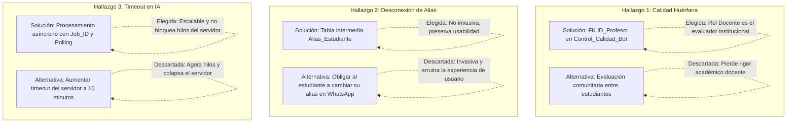

# Fase de Validación Técnica: Informe U1-01 de Validación del Diseño Técnico (Semestre IX)

**Curso:** 203453 · Diseño y Desarrollo de Software Educativo II · Semestre IX  
**Institución:** Universidad de Córdoba · Facultad de Educación y Ciencias Humanas · Licenciatura en Informática  
**Docente Líder:** Alexander Enrique Toscano Ricardo  
**Equipo de Desarrollo:** SICOCO Dev Team (José Daniel Durango Caballero, Jefersson Ramírez Oviedo, Jesús Daniel Ruiz Román, Jeyson David López Gorrostola)  
**Equipo Coevaluador:** EDUQUEST (Jorge Mogollón Díaz, Jorge Guzmán Aguirre, Germán Rivera Rosario)  
**Repositorio Oficial:** `https://github.com/JoseDanielDurango/sicoco-documentation.git` / `sicoco-framework`  

---

## 1. Contexto de Recepción y Punto de Partida

Al iniciar el **9no semestre** en la asignatura **Diseño y Desarrollo de Software Educativo II**, el equipo asumió la tarea de auditar formalmente el diseño técnico y computacional elaborado durante el 8vo semestre en *Diseño y Desarrollo de Software Educativo I* (asignatura 203447).

El objetivo de esta fase de validación técnica no consistió en una simple revisión superficial, sino en verificar exhaustivamente si la especificación recibida era suficiente, coherente y viable para construir el software real (**MVP**), identificando inconsistencias, omisiones y ambigüedades antes de iniciar la programación del código fuente en la Fase 4 de MODESEC.

### Documentación Recibida vs. Documentación Faltante

- **Documentos Recibidos:** Documento Técnico de Diseño y Fundamentación Pedagógico-Computacional, Especificación de Historias de Usuario, Modelo Entidad-Relación inicial (19 tablas en DBDiagram).
- **Documentos Faltantes Identificados:**
  1. *Blueprint técnico de servicios backend:* Ausencia de contratos de servicios formales (definición de endpoints REST, esquemas de payload JSON y códigos de estado HTTP).
  2. *Diccionario de datos detallado:* Ausencia de longitudes máximas para atributos de texto (`VARCHAR(n)`), lo que generaba riesgo de desbordamiento de almacenamiento en transcripciones extensas.

---

## 2. Hallazgos Críticos sobre el Modelo de Datos

Durante la auditoría del Modelo de Datos recibido se detectaron cuatro aspectos estructurales que requerían corrección inmediata:

| N° | Hallazgo | Ubicación Original | Tipo de Falla | Efecto sobre la Implementación |
| :---: | :--- | :--- | :---: | :--- |
| **1** | **Entidad Control de Calidad huérfana** | Capítulo VI, Dominio 6, Tabla `Control_Calidad_Bot` | **Omisión** | La tabla no contaba con clave foránea (`FK`) al evaluador. Las evaluaciones de fidelidad quedaban anónimas y se perdía la trazabilidad académica sobre qué docente calificó la precisión de la IA. |
| **2** | **Desconexión entre Alias de chat y Estudiante real** | Capítulo VI, Tablas `Mensaje_Original` y `Acuerdo_Equipo` | **Inconsistencia** | Al guardar el alias del remitente como texto libre (`VARCHAR`) sin una tabla de correspondencia al `ID_Estudiante`, el sistema no podía atribuir de forma automatizada las notas de participación ni asignar tareas a estudiantes matriculados. |
| **3** | **Encuestas desvinculadas de la sesión de trabajo** | Capítulo VI, Dominio 6, Tablas `Evaluacion_UX` y `Encuesta_Piloto` | **Omisión** | Las encuestas estaban enlazadas únicamente al estudiante pero no a la sesión de trabajo específica (`ID_Sesion`), impidiendo evaluar si un chat o dinámica grupal particular tuvo éxito pedagógico. |
| **4** | **Longitudes de datos ausentes** | Capítulo VI y Anexo B (DBDiagram) | **Omisión** | Los atributos `VARCHAR` y `TEXT` carecían de cotas numéricas. En bases de datos relacionales, esto genera errores de asignación de memoria e índices ineficientes ante transcripciones de miles de líneas. |

---

## 3. Hallazgos sobre el Contrato de Servicios y Backend

Al evaluar la arquitectura computacional del sistema para soportar el flujo del MVP, se identificaron fallas operativas severas:

### 3.1. Ausencia de Procesamiento Asíncrono para la IA (Riesgo Crítico de Timeout)
- **Problema:** En el diseño preliminar, el envío del chat a la API de Inteligencia Artificial (Gemini / OpenAI) se concebía como una petición HTTP sincrónica estándar (`Request -> Response`).
- **Efecto:** El procesamiento de transcripciones grupales con cientos de mensajes requiere entre 15 y 45 segundos de inferencia en el LLM. Los navegadores y servidores HTTP web cierran la conexión por `Timeout` a los 10 o 30 segundos, provocando que la extensión Chromium fallara de forma sistemática y degradara la experiencia del usuario.

### 3.2. Falta de Automatización en el Estado de Tareas
- **Problema:** La entidad `Tarea_Asignada` cuenta con el campo `Fecha_Limite`, pero el diseño no especificaba ningún mecanismo para actualizar su estado.
- **Efecto:** Las tareas permanecerían perpetuamente en estado `"Pendiente"`, ya que no existía un proceso de fondo que verificara las fechas de expiración para marcarlas como `"Vencida"`.

### 3.3. Contrato de Entrada del Scraper Web (DOM) Indefinido
- **Problema:** No se encontraba especificado el esquema de intercambio entre la extensión web (frontend) y el servidor backend para los nodos extraídos de WhatsApp Web, Discord o Teams.
- **Efecto:** Falta de desacoplamiento entre el script inyectado en el DOM y los controladores del backend.

---

## 4. Correcciones Propuestas y Alternativas Descartadas

Para alcanzar el nivel superior de madurez ingenieril, el equipo no solo propuso soluciones, sino que analizó las alternativas disponibles y justificó su descarte:

### Tabla Comparativa de Decisiones

| Hallazgo | Corrección Propuesta (Adoptada) | Alternativa Considerada | Motivo del Descarte de la Alternativa |
| :--- | :--- | :--- | :--- |
| **Control de Calidad Huérfana** | Incorporar `ID_Profesor` (FK) a la tabla `Control_Calidad_Bot`. | Permitir evaluación abierta vinculada a `ID_Estudiante`. | Descartada porque, según los perfiles pedagógicos de MODESEC, el docente es el tutor responsable de validar las métricas objetivas de aprendizaje. |
| **Desconexión de Alias** | Crear una relación o catálogo intermedio `Alias_Estudiante` (`ID_Alias`, `Alias_Texto`, `ID_Estudiante`) para homologar apodos de chat con la matrícula oficial. | Obligar por UX al estudiante a renombrar su perfil en WhatsApp/Discord antes de exportar el chat. | Descartada por ser altamente invasiva. WhatsApp y Discord son herramientas personales/académicas mixtas; obligar a modificar el perfil deteriora la adopción. |
| **Procesamiento de IA Sincrónico** | Implementar un servicio asíncrono en el backend: el cliente envía el chat mediante `POST`, el backend encola la tarea y responde inmediatamente con un `Job_ID`. Luego, el cliente consulta el estado (`Polling` o WebSockets). | Aumentar el límite de `Timeout` del servidor a 5 o 10 minutos. | Descartada porque bloquea hilos de conexión en el servidor web. Múltiples equipos enviando chats en paralelo colapsarían la memoria y los sockets del backend. |
| **Actualizador de Tareas** | Diseñar un servicio programado en backend (*Cron Job* o tarea periódica) que revise diariamente las fechas límites de las tareas activas. | Actualizar el estado únicamente cuando el estudiante abra la pantalla de tareas. | Descartada porque si el estudiante no ingresa al sistema, el docente vería tareas con fecha caducada aún marcadas como pendientes en los reportes globales. |

---

## 5. Efecto Conjunto sobre la Implementación de Fase 4

La interconexión de estos hallazgos demostró que la persistencia de datos y la arquitectura de backend debían desacoplarse y robustecerse:

1. **Definición de Arquitectura Backend:** Se resolvió construir un backend modular y desacoplado utilizando **NestJS** y **TypeScript**, permitiendo estructurar servicios REST limpios, controladores y módulos inyectables.
2. **Estrategia Híbrida de Persistencia:** Para resolver la complejidad de almacenar transcripciones desestructuradas de chats masivos (cientos de mensajes con metadatos volátiles) sin saturar un esquema relacional rígido, se introdujo **MongoDB** mediante **Mongoose** en el framework de backend (`sicoco-framework`), manteniendo la concordancia lógica con las entidades de negocio.
3. **Contratos Documentados mediante OpenAPI / Swagger:** Para erradicar la ambigüedad en los endpoints, se configuró Swagger (`@nestjs/swagger`) generando especificaciones interactivas en tiempo real en `/api`.

Este informe de validación técnica constituyó el insumo fundamental para evolucionar el **Modelo Entidad-Relación a la Versión 2 (V2)** y dar paso a la codificación activa del framework backend del proyecto SICOCO durante este semestre.
