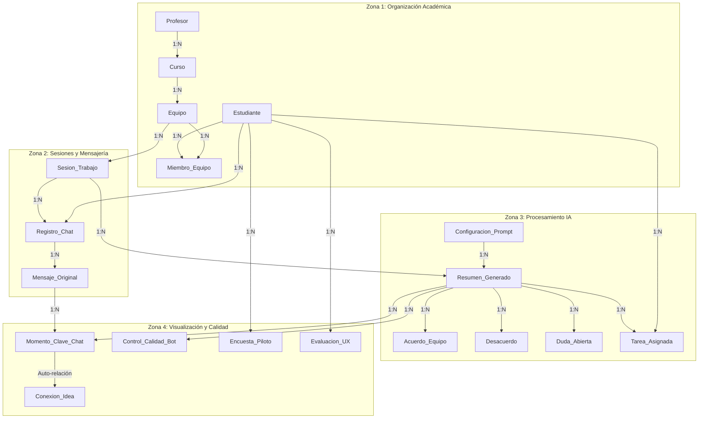

# Modelo Entidad-Relación Actualizado (Versión 2 - Semestre IX)

**Proyecto:** SICOCO (Sintetizador de Co-creación Colaborativa)  
**Asignatura:** 203453 · Diseño y Desarrollo de Software Educativo II  
**Periodo:** 2026-2 · Semestre IX · Universidad de Córdoba  
**Recursos Visuales Asociados:** [SICOCO v2.png](../Resources/SICOCO_v2.png) | [SICOCO v2 Light.png](../Resources/SICOCO_v2_Light.png) | [Diagrama DBML v2](../Resources/diagrama_bd_v2.dbml) | [Documento PDF MER](../Resources/MER%20-%20SICOCO.pdf)  

---

## 1. Justificación y Novedades del Modelo Relacional V2

A partir del análisis realizado en el **Informe de Validación Técnica (U1-01)** y la coevaluación con pares académicos, el Modelo Entidad-Relación de SICOCO fue refinado e integrado en su **Versión 2 (V2)** para corregir inconsistencias y cubrir la totalidad de requerimientos pedagógicos y computacionales de MODESEC.

### Mejoras e Integraciones Clave de la Versión 2

1. **Entidad `Conexion_Idea` (Auto-relación Reflexiva):**  
   Se incorporó formalmente la relación de muchos a muchos recursiva en la entidad `Momento_Clave_Chat`. Esto materializa el principio fundamental de **Co-Creación**, permitiendo trazar en la base de datos cómo una idea preliminar expresada por un miembro del equipo conecta, inspira o detona la propuesta o solución formulada por otro estudiante (Pregunta 16 de la Entrevista).
2. **Entidad `Evaluacion_UX`:**  
   Se agregó al esquema para completar el ciclo de auditoría del Bloque 6 (Evaluación y Pruebas), registrando métricas de claridad visual, diferenciación de tareas y comentarios cualitativos de la interfaz del Dashboard (Pregunta 18).
3. **Atributos de Privacidad y Blindaje:**  
   - Se añadió la bandera booleana `Es_Confidencial` en la tabla `Registro_Chat` para garantizar que los equipos puedan marcar chats sensibles.
   - Se añadió el campo `Requiere_Aprobacion_Profesor` en la tabla `Equipo` para dar control al docente sobre la conformación de los grupos de trabajo (Requerimientos de Seguridad del Bloque 7).
4. **Restablecimiento de Clave Foránea en `Resumen_Generado`:**  
   Se formalizó la relación `ID_Configuracion` (FK hacia `Configuracion_Prompt`), resolviendo el aislamiento que presentaba el catálogo de prompts frente a los resúmenes generados.
5. **Depuración y Normalización de Sintaxis:**  
   Se eliminaron relaciones huérfanas o erróneas presentes al final de la versión anterior (tales como referencias truncadas de `Curso` a sí misma).

---

## 2. Estructura por Zonas Funcionales del Modelo V2

El modelo relacional se encuentra organizado en cuatro zonas lógicas que responden a los dominios del framework MODESEC:



### Zona 1: Usuarios, Roles y Organización Académica
- **`Estudiante`:** Almacena la identidad de los estudiantes (`ID_Estudiante`, `Numero_Identidad_Matricula`, `Nombres`, `Apellidos`, `Correo_Institucional`, `Contraseña_Encriptada`, `Semestre_Actual`, `Programa_Academico`, `Fecha_Registro`).
- **`Profesor`:** Perfil de docentes y supervisores (`ID_Profesor`, `Numero_Empleado`, `Nombres`, `Apellidos`, `Correo_Institucional`, `Departamento`, `Permiso_Sistema`).
- **`Curso`:** Agrupador formal de asignaturas (`ID_Curso`, `Codigo_Materia`, `Nombre_Materia`, `Semestre_Academico`, `ID_Profesor_Responsable`).
- **`Equipo`:** Núcleo de co-creación (`ID_Equipo`, `Nombre_Equipo`, `ID_Curso`, `Fecha_Creacion`, `Requiere_Aprobacion_Profesor`).
- **`Miembro_Equipo`:** Tabla asociativa muchos a muchos (`ID_Relacion`, `ID_Estudiante`, `ID_Equipo`, `Rol_En_Equipo`, `Fecha_Union`).

### Zona 2: Entradas de Datos y Sesiones de Trabajo
- **`Sesion_Trabajo`:** Representa una sesión o reunión lógica (`ID_Sesion`, `ID_Equipo`, `Fecha_Reunion`, `Objetivo_General`, `Plataforma_Origen`, `Duracion_Estimada`).
- **`Registro_Chat`:** Representa la ingesta del archivo o captura web (`ID_Registro`, `ID_Sesion`, `ID_Estudiante_Ingresa`, `Origen_Metadata`, `Formato_Entrada`, `Tamaño_Datos`, `Es_Confidencial`, `Created_At`).
- **`Mensaje_Original`:** Descomposición atómica de la conversación (`ID_Mensaje`, `ID_Registro`, `Alias_Remitente`, `Cuerpo_Del_Mensaje`, `Fecha_Hora_Mensaje`).

### Zona 3: Procesamiento de IA y Salidas MODESEC
- **`Configuracion_Prompt`:** Catálogo de ingeniería de prompts (`ID_Configuracion`, `Nombre_Estilo`, `Texto_Instruccion_IA`, `Estado_Activo`).
- **`Resumen_Generado`:** Síntesis consolidada de la IA (`ID_Resumen`, `ID_Sesion`, `ID_Configuracion`, `Texto_Final_Plano`, `Modelo_IA_Usado`, `Consumo_Tokens`, `Fecha_Generacion`, `ID_Editor_Ultimo`, `Updated_At`).
- **`Acuerdo_Equipo`:** Consensos y acuerdos detectados (`ID_Acuerdo`, `ID_Resumen`, `Descripcion_Solucion`, `Nivel_Importancia`, `Alias_Quien_Propone`).
- **`Desacuerdo`:** Debates y posturas opuestas (`ID_Desacuerdo`, `ID_Resumen`, `Tema_Debate`, `Descripcion_Oposicion`, `Estado_Resolucion`).
- **`Duda_Abierta`:** Preguntas no resueltas (`ID_Duda`, `ID_Resumen`, `Pregunta_Principal`, `Relacionado_Con_Tema`).
- **`Tarea_Asignada`:** Compromisos de trabajo To-Do (`ID_Tarea`, `ID_Resumen`, `Titulo_Actividad`, `ID_Estudiante_Asignado`, `Estatus`, `Fecha_Limite`).

### Zona 4: Visualización y Control de Calidad
- **`Momento_Clave_Chat`:** Hitos cronológicos para la línea de tiempo (`ID_Momento`, `ID_Resumen`, `Marca_Tiempo_Aproximada`, `ID_Mensaje_Relacionado`, `Alias_Usuario`, `Evento`).
- **`Conexion_Idea`:** Auto-relación para el grafo de co-creación (`ID_Conexion`, `ID_Idea_Base`, `ID_Aporte_Extra`).
- **`Control_Calidad_Bot`:** Auditoría de precisión de la IA (`ID_Test`, `ID_Resumen`, `Cantidad_Falsos_Positivos`, `Calificacion_Fidelidad_Texto`, `Comentario_Tecnico`).
- **`Evaluacion_UX`:** Usabilidad del dashboard (`ID_Eval_UX`, `ID_Estudiante`, `Claridad_Visual`, `Separacion_Vista_Tareas`, `Sugerencias_Extra`).
- **`Encuesta_Piloto`:** Impacto educativo de MODESEC (`ID_Encuesta`, `ID_Estudiante`, `Mejor_Comprension_Objetivos`, `Nivel_Apoyo_Grupo`, `Fecha_Respuesta`).

---

## 3. Código DBML Oficial del Modelo V2

```dbml
// =====================================================================
// SICOCO: Sintetizador de Co-creación Colaborativa
// Modelo Entidad-Relación V2 (Semestre IX - 2026-2)
// =====================================================================

// --- ZONA 1: Usuarios, Roles y Organización Académica ---

Table Estudiante {
  ID_Estudiante integer [primary key, increment]
  Numero_Identidad_Matricula varchar [unique, not null]
  Nombres varchar [not null]
  Apellidos varchar [not null]
  Correo_Institucional varchar [unique, not null]
  Contraseña_Encriptada varchar [not null]
  Semestre_Actual integer
  Programa_Academico varchar
  Fecha_Registro timestamp [default: `now()`]
}

Table Profesor {
  ID_Profesor integer [primary key, increment]
  Numero_Empleado varchar [unique, not null]
  Nombres varchar [not null]
  Apellidos varchar [not null]
  Correo_Institucional varchar [unique, not null]
  Departamento varchar
  Permiso_Sistema integer [default: 1]
}

Table Curso {
  ID_Curso integer [primary key, increment]
  Codigo_Materia varchar [not null]
  Nombre_Materia varchar [not null]
  Semestre_Academico varchar [not null]
  ID_Profesor_Responsable integer [not null]
}

Table Equipo {
  ID_Equipo integer [primary key, increment]
  Nombre_Equipo varchar [not null]
  ID_Curso integer [not null]
  Fecha_Creacion timestamp [default: `now()`]
  Requiere_Aprobacion_Profesor boolean [default: false]
}

Table Miembro_Equipo {
  ID_Relacion integer [primary key, increment]
  ID_Estudiante integer [not null]
  ID_Equipo integer [not null]
  Rol_En_Equipo varchar [default: 'Participante']
  Fecha_Union timestamp [default: `now()`]
}

// --- ZONA 2: Entradas de Datos y Sesiones de Trabajo ---

Table Sesion_Trabajo {
  ID_Sesion integer [primary key, increment]
  ID_Equipo integer [not null]
  Fecha_Reunion timestamp [default: `now()`]
  Objetivo_General text
  Plataforma_Origen varchar
  Duracion_Estimada integer
}

Table Registro_Chat {
  ID_Registro integer [primary key, increment]
  ID_Sesion integer [not null]
  ID_Estudiante_Ingresa integer [not null]
  Origen_Metadata varchar
  Formato_Entrada varchar
  Tamaño_Datos integer
  Es_Confidencial boolean [default: false]
  Created_At timestamp [default: `now()`]
}

Table Mensaje_Original {
  ID_Mensaje integer [primary key, increment]
  ID_Registro integer [not null]
  Alias_Remitente varchar [not null]
  Cuerpo_Del_Mensaje text [not null]
  Fecha_Hora_Mensaje timestamp
}

// --- ZONA 3: Procesamiento de IA y Salidas (MODESEC) ---

Table Configuracion_Prompt {
  ID_Configuracion integer [primary key, increment]
  Nombre_Estilo varchar [not null] // Ej: Rápido, Formal/Serio
  Texto_Instruccion_IA text [not null]
  Estado_Activo boolean [default: true]
}

Table Resumen_Generado {
  ID_Resumen integer [primary key, increment]
  ID_Sesion integer [not null]
  ID_Configuracion integer [not null] // Vinculación recuperada en V2
  Texto_Final_Plano text
  Modelo_IA_Usado varchar
  Consumo_Tokens integer
  Fecha_Generacion timestamp [default: `now()`]
  ID_Editor_Ultimo integer
  Updated_At timestamp
}

Table Acuerdo_Equipo {
  ID_Acuerdo integer [primary key, increment]
  ID_Resumen integer [not null]
  Descripcion_Solucion text [not null]
  Nivel_Importancia varchar
  Alias_Quien_Propone varchar
}

Table Desacuerdo {
  ID_Desacuerdo integer [primary key, increment]
  ID_Resumen integer [not null]
  Tema_Debate varchar [not null]
  Descripcion_Oposicion text
  Estado_Resolucion varchar [default: 'Activo']
}

Table Duda_Abierta {
  ID_Duda integer [primary key, increment]
  ID_Resumen integer [not null]
  Pregunta_Principal text [not null]
  Relacionado_Con_Tema varchar
}

Table Tarea_Asignada {
  ID_Tarea integer [primary key, increment]
  ID_Resumen integer [not null]
  Titulo_Actividad varchar [not null]
  ID_Estudiante_Asignado integer
  Estatus varchar [default: 'Pendiente']
  Fecha_Limite date
}

// --- ZONA 4: Visualización y Evaluación ---

Table Momento_Clave_Chat {
  ID_Momento integer [primary key, increment]
  ID_Resumen integer [not null]
  Marca_Tiempo_Aproximada timestamp
  ID_Mensaje_Relacionado integer
  Alias_Usuario varchar
  Evento varchar // 'Idea Nueva', 'Solución', 'Debate'
}

Table Conexion_Idea {
  ID_Conexion integer [primary key, increment]
  ID_Idea_Base integer [not null]
  ID_Aporte_Extra integer [not null]
}

Table Control_Calidad_Bot {
  ID_Test integer [primary key, increment]
  ID_Resumen integer [not null]
  Cantidad_Falsos_Positivos integer [default: 0]
  Calificacion_Fidelidad_Texto integer
  Comentario_Tecnico text
}

Table Evaluacion_UX {
  ID_Eval_UX integer [primary key, increment]
  ID_Estudiante integer [not null]
  Claridad_Visual integer // Escala 1 a 5
  Separacion_Vista_Tareas boolean
  Sugerencias_Extra text
}

Table Encuesta_Piloto {
  ID_Encuesta integer [primary key, increment]
  ID_Estudiante integer [not null]
  Mejor_Comprension_Objetivos boolean
  Nivel_Apoyo_Grupo integer // Escala Likert 1 a 5
  Fecha_Respuesta timestamp [default: `now()`]
}

// --- CLAVES FORÁNEAS (RELACIONES) ---

Ref: Curso.ID_Profesor_Responsable > Profesor.ID_Profesor
Ref: Equipo.ID_Curso > Curso.ID_Curso
Ref: Miembro_Equipo.ID_Estudiante > Estudiante.ID_Estudiante
Ref: Miembro_Equipo.ID_Equipo > Equipo.ID_Equipo

Ref: Sesion_Trabajo.ID_Equipo > Equipo.ID_Equipo
Ref: Registro_Chat.ID_Sesion > Sesion_Trabajo.ID_Sesion
Ref: Registro_Chat.ID_Estudiante_Ingresa > Estudiante.ID_Estudiante
Ref: Mensaje_Original.ID_Registro > Registro_Chat.ID_Registro

Ref: Resumen_Generado.ID_Sesion > Sesion_Trabajo.ID_Sesion
Ref: Resumen_Generado.ID_Configuracion > Configuracion_Prompt.ID_Configuracion

Ref: Acuerdo_Equipo.ID_Resumen > Resumen_Generado.ID_Resumen
Ref: Desacuerdo.ID_Resumen > Resumen_Generado.ID_Resumen
Ref: Duda_Abierta.ID_Resumen > Resumen_Generado.ID_Resumen
Ref: Tarea_Asignada.ID_Resumen > Resumen_Generado.ID_Resumen
Ref: Tarea_Asignada.ID_Estudiante_Asignado > Estudiante.ID_Estudiante

Ref: Momento_Clave_Chat.ID_Resumen > Resumen_Generado.ID_Resumen
Ref: Momento_Clave_Chat.ID_Mensaje_Relacionado > Mensaje_Original.ID_Mensaje
Ref: Conexion_Idea.ID_Idea_Base > Momento_Clave_Chat.ID_Momento
Ref: Conexion_Idea.ID_Aporte_Extra > Momento_Clave_Chat.ID_Momento

Ref: Control_Calidad_Bot.ID_Resumen > Resumen_Generado.ID_Resumen
Ref: Evaluacion_UX.ID_Estudiante > Estudiante.ID_Estudiante
Ref: Encuesta_Piloto.ID_Estudiante > Estudiante.ID_Estudiante
```

---

## 4. Estado de Validación y Transición a la Implementación

Con esta especificación V2, el equipo de desarrollo cerró el vacío estructural detectado en la auditoría técnica. El diseño no solo garantiza la coherencia referencial en bases de datos relacionales tradicionales, sino que sirvió como guía directa para proyectar los esquemas de persistencia no relacionales (Mongoose) implementados en el framework backend de SICOCO.
