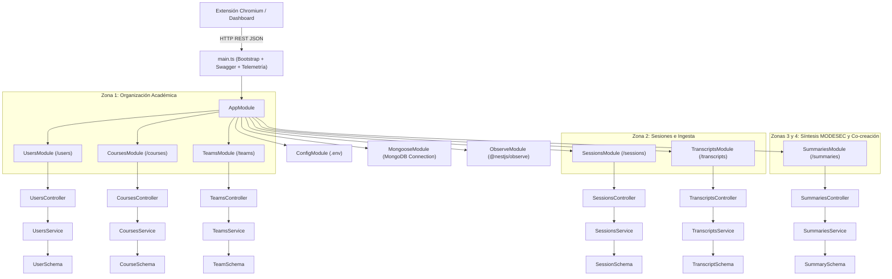

# Arquitectura Técnica de Backend y API REST (sicoco-framework)

**Proyecto:** SICOCO (Sintetizador de Co-creación Colaborativa)  
**Módulo:** Framework de Backend y Capa de Persistencia (`sicoco-framework`)  
**Asignatura:** 203453 · Diseño y Desarrollo de Software Educativo II · Semestre IX  
**Periodo:** 2026-2 · Universidad de Córdoba  

---

## 1. Visión General del Framework de Backend

Durante el **9no semestre**, el proyecto SICOCO trascendió formalmente la fase de diseño y planificación teórica (Fases 1 a 3 de MODESEC) para dar inicio a la **Fase 4: Producción y Desarrollo**.

Para garantizar un backend robusto, escalable, tipado y mantenible, se estructuró la solución sobre el framework **NestJS** en su versión más moderna (v12), utilizando **TypeScript** con arquitectura nativa de módulos ECMAScript (`"type": "module"`). La persistencia de datos se apoya en **MongoDB** a través de **Mongoose**, implementando una arquitectura de capas con separación estricta de responsabilidades: Controladores, Servicios, Objetos de Transferencia de Datos (DTOs) y Esquemas de Datos.

El backend cuenta con **6 módulos funcionales y operativos** que cubren la totalidad de las 4 zonas del modelo relacional V2 de MODESEC:



---

## 2. Stack Tecnológico y Dependencias Principales

La arquitectura técnica se encuentra configurada en el archivo `package.json` de `sicoco-framework`:

| Categoría | Tecnología / Librería | Versión | Propósito en el Proyecto |
| :--- | :--- | :---: | :--- |
| **Framework Base** | `@nestjs/core`, `@nestjs/common` | `^12.0.1` | Arquitectura empresarial modular con inyección de dependencias e inversión de control. |
| **Plataforma HTTP** | `@nestjs/platform-express` | `^12.0.1` | Motor de enrutamiento y procesamiento de peticiones HTTP REST. |
| **Persistencia NoSQL** | `@nestjs/mongoose`, `mongoose` | `^12.0.0` / `^9.11.4` | Modelado y persistencia orientada a documentos para gestión flexible de entidades y mensajes. |
| **Configuración** | `@nestjs/config` | `^12.0.1` | Carga asíncrona de variables de entorno desde `.env` con soporte global. |
| **Documentación API** | `@nestjs/swagger` | `^12.1.0` | Generación automática de especificaciones OpenAPI y UI interactiva en tiempo real. |
| **Observabilidad** | `@nestjs/observe` | `^0.3.0` | Instrumentación, métricas y telemetría de rendimiento del servidor. |
| **Testing** | `vitest`, `@nestjs/testing` | `^4.1.2` / `^12.0.1` | Suite de pruebas unitarias ultrarrápida basada en Vite con soporte nativo de ESM. |
| **E2E Testing** | `supertest` | `^7.0.0` | Ejecución de pruebas de integración extremo a extremo contra los endpoints REST. |
| **Linting y Calidad** | `oxlint`, `oxlint-tsgolint` | `^1.58.0` | Linter de alto rendimiento basado en Rust con análisis de tipos TypeScript. |
| **Formateo de Código** | `prettier` | `^3.4.2` | Estandarización de estilo de código en todo el repositorio. |

---

## 3. Justificación de la Estrategia de Persistencia (MongoDB & Mongoose)

Si bien en el primer semestre se diseñó un Modelo Entidad-Relación relacional de 19 tablas, el equipo determinó en la **Validación Técnica U1-01** que las características operativas de SICOCO requerían un esquema híbrido y escalable:

1. **Naturaleza Jerárquica y Semi-estructurada de los Chats:** Las transcripciones de mensajería (WhatsApp, Discord, Teams) contienen una estructura arbórea con hilos de respuestas, reacciones, metadatos variables y textos de longitud impredecible. Los esquemas basados en documentos JSON/BSON de MongoDB permiten almacenar estos bloques de mensajes (`ChatMessage`) embebidos sin sobrecargar un motor SQL con cientos de miles de filas fragmentadas.
2. **Estructura Flexible de los Cuatro Pilares MODESEC:** La síntesis generada por el LLM produce listas de tamaño variable de acuerdos, desacuerdos, dudas abiertas y tareas asignadas. Almacenarlas como subdocumentos tipados en MongoDB agiliza las consultas en un único viaje de red (*single round-trip*) hacia el dashboard del estudiante.
3. **Velocidad de Iteración en Fase 4:** Mongoose proporciona validación estricta de esquemas, tipos y restricciones en tiempo de compilación y ejecución, facilitando adaptar los esquemas conforme evolucionan los requerimientos pedagógicos de MODESEC sin requerir migraciones complejas de base de datos relacional.
4. **Mapeo Limpio de Entidades Académicas:** Entidades como Usuarios, Cursos y Equipos se definen con decoradores `@Schema()` y `@Prop()`, garantizando unicidad en correos institucionales, códigos de materia y claves de sesión.

---

## 4. Estructura de Módulos y Código Fuente

El código se encuentra organizado dentro de la carpeta `src/` del repositorio `sicoco-framework`:

```
src/
├── app.controller.spec.ts          # Pruebas del controlador raíz
├── app.controller.ts               # Controlador base
├── app.module.ts                   # Módulo raíz que ensambla los 6 módulos funcionales
├── app.service.ts                  # Servicio base
├── main.ts                         # Punto de entrada y configuración de Swagger OpenAPI
├── users/                          # [Zona 1] Módulo de Gestión de Usuarios y Estudiantes
│   ├── dto/
│   │   ├── create-user.dto.ts
│   │   └── update-user.dto.ts
│   ├── entities/
│   │   └── user.entity.ts
│   ├── schemas/
│   │   └── user.schema.ts          # Colección 'users'
│   ├── users.controller.spec.ts
│   ├── users.controller.ts
│   ├── users.module.ts
│   ├── users.service.spec.ts
│   └── users.service.ts
├── courses/                        # [Zona 1] Módulo de Gestión de Cursos Académicos
│   ├── dto/
│   │   ├── create-course.dto.ts
│   │   └── update-course.dto.ts
│   ├── schemas/
│   │   └── course.schema.ts        # Colección 'courses'
│   ├── courses.controller.spec.ts
│   ├── courses.controller.ts
│   ├── courses.module.ts
│   ├── courses.service.spec.ts
│   └── courses.service.ts
├── teams/                          # [Zona 1] Módulo de Equipos Colaborativos
│   ├── dto/
│   │   ├── create-team.dto.ts
│   │   └── update-team.dto.ts
│   ├── schemas/
│   │   └── team.schema.ts          # Colección 'teams' (subdocumentos TeamMember)
│   ├── teams.controller.spec.ts
│   ├── teams.controller.ts
│   ├── teams.module.ts
│   ├── teams.service.spec.ts
│   └── teams.service.ts
├── sessions/                       # [Zona 2] Módulo de Sesiones de Trabajo Colaborativo
│   ├── dto/
│   │   ├── create-session.dto.ts
│   │   └── update-session.dto.ts
│   ├── schemas/
│   │   └── session.schema.ts       # Colección 'sessions'
│   ├── sessions.controller.spec.ts
│   ├── sessions.controller.ts
│   ├── sessions.module.ts
│   ├── sessions.service.spec.ts
│   └── sessions.service.ts
├── transcripts/                    # [Zona 2] Módulo de Ingesta de Transcripciones y Mensajes
│   ├── dto/
│   │   ├── create-transcript.dto.ts
│   │   └── update-transcript.dto.ts
│   ├── schemas/
│   │   └── transcript.schema.ts    # Colección 'transcripts' (subdocumentos ChatMessage)
│   ├── transcripts.controller.spec.ts
│   ├── transcripts.controller.ts
│   ├── transcripts.module.ts
│   ├── transcripts.service.spec.ts
│   └── transcripts.service.ts
└── summaries/                      # [Zonas 3 y 4] Motor de Síntesis MODESEC y Línea de Tiempo
    ├── dto/
    │   ├── create-summary.dto.ts
    │   ├── update-summary.dto.ts
    │   └── generate-summary.dto.ts
    ├── schemas/
    │   └── summary.schema.ts       # Colección 'summaries' (Acuerdos, Desacuerdos, Dudas, Tareas, Timeline)
    ├── summaries.controller.spec.ts
    ├── summaries.controller.ts
    ├── summaries.module.ts
    ├── summaries.service.spec.ts
    └── summaries.service.ts
```

### 4.1. Configuración de Inicio y Swagger (`main.ts`)
El servidor inicializa la aplicación NestJS integrando el instrumento de telemetría `@nestjs/observe` y expone la documentación OpenAPI Swagger en la ruta `/api` con las etiquetas de los 6 módulos:

```typescript
import { NestFactory } from '@nestjs/core';
import { SwaggerModule, DocumentBuilder } from '@nestjs/swagger';
import { AppModule, ObserveInstrument } from './app.module.js';

async function bootstrap() {
  const app = await NestFactory.create(AppModule, {
    instrument: ObserveInstrument,
  });

  const config = new DocumentBuilder()
    .setTitle('Sicoco API')
    .setDescription('API documentation for Sicoco - Collaborative Co-creation Synthesizer (MODESEC)')
    .setVersion('1.0')
    .addTag('users', 'Operaciones con usuarios y roles del sistema')
    .addTag('courses', 'Gestión de asignaturas y cursos académicos')
    .addTag('teams', 'Gestión de equipos colaborativos y asignación de miembros')
    .addTag('sessions', 'Sesiones de trabajo colaborativo y origen de plataforma')
    .addTag('transcripts', 'Ingesta de transcripciones y mensajes extraídos')
    .addTag('summaries', 'Motor de síntesis MODESEC (Acuerdos, Desacuerdos, Dudas, Tareas y Línea de Tiempo)')
    .build();
    
  const documentFactory = () => SwaggerModule.createDocument(app, config);
  SwaggerModule.setup('api', app, documentFactory);

  await app.listen(process.env.PORT ?? 3000);
}
await bootstrap();
```

---

### 4.2. Módulo de Usuarios (`UsersModule` - `/users`)
- **Propósito:** Gestión de identidades institucionales (estudiantes y docentes).
- **Esquema de Datos (`user.schema.ts`):** Define el usuario con campos `name` (requerido), `email` (requerido y único) y `age` (opcional), con marcas temporales automáticas (`timestamps: true`).
- **Operaciones REST (`users.controller.ts`):**
  - `POST /users`: Registra un nuevo usuario en la base de datos a partir del DTO.
  - `GET /users`: Consulta y retorna la lista completa de usuarios registrados.
  - `GET /users/:id`: Busca un usuario específico mediante su identificador único de MongoDB (`_id`).
  - `PATCH /users/:id`: Aplica modificaciones parciales a los datos del usuario.
  - `DELETE /users/:id`: Elimina el registro del usuario.

---

### 4.3. Módulo de Cursos (`CoursesModule` - `/courses`)
- **Propósito:** Gestión de materias académicas según los planes de estudio de la Universidad de Córdoba.
- **Esquema de Datos (`course.schema.ts`):** Vinculado a la colección `'courses'`, modela la asignatura con los atributos:
  - `code` (cadena única, requerida y limpia de espacios).
  - `name` (nombre de la materia, requerido).
  - `academicSemester` (semestre académico, ej. `"2026-2"`, requerido).
  - `instructor` (docente a cargo de la materia).
  - `description` (descripción u objetivos de la asignatura).
  - `isActive` (estado booleano, por defecto `true`).
  - `timestamps` automáticos de creación y actualización.
- **Operaciones REST (`courses.controller.ts`):**
  - `POST /courses`: Crea una nueva materia académica.
  - `GET /courses`: Lista todas las materias creadas.
  - `GET /courses/:id`: Obtiene la información detallada de una asignatura.
  - `PATCH /courses/:id`: Actualiza datos de la materia (docente, estado, etc.).
  - `DELETE /courses/:id`: Elimina la asignatura.

---

### 4.4. Módulo de Equipos Colaborativos (`TeamsModule` - `/teams`)
- **Propósito:** Representa los grupos de trabajo estudiantil conformados en el marco de una materia académica.
- **Esquema de Datos (`team.schema.ts`):**
  - `name`: Nombre del equipo colaborativo.
  - `courseId`: Referencia al curso académico contenedor.
  - `requiresTeacherApproval`: Bandera de seguridad (del modelo V2) para requerir autorización docente.
  - `members`: Lista de subdocumentos embebidos `TeamMember` con:
    - `studentId`: Identificador del estudiante.
    - `studentName`: Nombre del estudiante.
    - `role`: Rol en el equipo (`leader`, `member`, `guest`).
    - `joinedAt`: Fecha de incorporación.
  - `isActive`: Estado activo/inactivo del equipo.
- **Operaciones REST (`teams.controller.ts`):**
  - `POST /teams`: Crea un nuevo equipo con membresía inicial.
  - `GET /teams`: Lista los equipos registrados (con filtro opcional por `courseId`).
  - `GET /teams/:id`: Consulta la información detallada del equipo y sus miembros.
  - `PATCH /teams/:id`: Actualiza nombre o bandera de aprobación docente.
  - `POST /teams/:id/members`: Incorpora un nuevo estudiante al equipo con su respectivo rol.
  - `DELETE /teams/:id/members/:studentId`: Remueve a un estudiante del equipo colaborativo.
  - `DELETE /teams/:id`: Elimina el equipo.

---

### 4.5. Módulo de Sesiones de Trabajo (`SessionsModule` - `/sessions`)
- **Propósito:** Registro y seguimiento de reuniones sincrónicas y asincrónicas realizadas por los equipos en plataformas virtuales.
- **Esquema de Datos (`session.schema.ts`):**
  - `title`: Título representativo de la reunión.
  - `generalObjective`: Propósito pedagógico o meta de trabajo de la sesión.
  - `teamId`: Identificador del equipo titular de la reunión.
  - `meetingDate`: Fecha y hora de realización del encuentro.
  - `platformOrigin`: Plataforma de origen (`whatsapp`, `discord`, `teams`, `meet`, `slack`, `other`).
  - `estimatedDurationMinutes`: Duración aproximada en minutos.
  - `status`: Estado de la sesión (`scheduled`, `in_progress`, `completed`, `cancelled`).
- **Operaciones REST (`sessions.controller.ts`):**
  - `POST /sessions`: Registra una nueva sesión de trabajo colaborativo.
  - `GET /sessions`: Lista las sesiones (con filtro opcional por `teamId`).
  - `GET /sessions/:id`: Obtiene la ficha completa de una sesión.
  - `PATCH /sessions/:id`: Actualiza estado, objetivo o duración de la reunión.
  - `DELETE /sessions/:id`: Elimina el registro de la sesión.

---

### 4.6. Módulo de Ingesta de Transcripciones (`TranscriptsModule` - `/transcripts`)
- **Propósito:** Recepción, estructuración y almacenamiento persistente de los mensajes extraídos por la extensión Chromium desde el DOM de WhatsApp Web, Discord o Teams.
- **Esquema de Datos (`transcript.schema.ts`):**
  - `sessionId`: Identificador de la sesión vinculada.
  - `sourcePlatform`: Plataforma detectada por el scraper.
  - `format`: Formato de ingesta (`scraped_dom`, `exported_txt`, `json_api`).
  - `dataSize`: Número total de bytes o caracteres recibidos.
  - `isConfidential`: Bandera de privacidad (del modelo V2) para restringir accesos.
  - `messages`: Colección jerárquica de subdocumentos embebidos `ChatMessage`:
    - `senderName`: Nombre del participante visible en la interfaz.
    - `senderId`: Identificador de usuario (si está autenticado).
    - `senderAlias`: Apodo o número telefónico crudo (para mapeo posterior en `Alias_Estudiante`).
    - `timestamp`: Marca de tiempo original del mensaje.
    - `content`: Texto transcrito del mensaje.
    - `messageOrder`: Secuencia cronológica del mensaje dentro de la sesión.
    - `platformMetadata`: Metadatos variables (reacciones, menciones, citas).
- **Operaciones REST (`transcripts.controller.ts`):**
  - `POST /transcripts`: Crea el registro contenedor de transcripción con mensajes iniciales.
  - `GET /transcripts`: Lista transcripciones (con filtro opcional por `sessionId`).
  - `GET /transcripts/:id`: Recupera la transcripción íntegra con todos sus mensajes cronológicos.
  - `POST /transcripts/:id/messages`: Ingesta masiva o incremental de mensajes (`ChatMessageDto[]`) generados por el scraper web.
  - `PATCH /transcripts/:id`: Modifica banderas de privacidad o metadatos de la transcripción.
  - `DELETE /transcripts/:id`: Elimina la transcripción.

---

### 4.7. Módulo de Síntesis y Resúmenes MODESEC (`SummariesModule` - `/summaries`)
- **Propósito:** Núcleo inteligente de SICOCO. Estructura el resumen pedagógico bajo los 4 pilares de MODESEC y la línea de tiempo reflexiva de co-creación (`Conexion_Idea`), implementando el flujo asíncrono anti-timeout diseñado en el Informe U1-01.
- **Esquema de Datos (`summary.schema.ts`):**
  - **Identificación y Telemetría:** `sessionId`, `jobId` (UUID único del procesamiento asíncrono), `aiModelUsed`, `tokenUsage`, `executionTimeMs`, `status` (`queued`, `processing`, `completed`, `failed`), `errorMessage`.
  - **Pilar 1 - Acuerdos (`agreements`):** Lista de consensos (`title`, `description`, `consensusLevel`: `unanimous`/`majority`/`partial`, `participantsInvolved`).
  - **Pilar 2 - Desacuerdos (`disagreements`):** Registro de debates pedagógicos (`topic`, `opposingViews`, `unresolved`, `debateSnippet`).
  - **Pilar 3 - Dudas Abiertas (`doubts`):** Interrogantes no resueltos (`question`, `askedBy`, `category`: `conceptual`/`technical`/`organizational`, `urgencyLevel`: `low`/`medium`/`high`).
  - **Pilar 4 - Tareas Asignadas (`tasks`):** Compromisos con trazabilidad (`title`, `assignedTo`, `dueDate`, `priority`: `low`/`medium`/`high`, `status`: `pending`/`in_progress`/`completed`/`overdue`).
  - **Línea de Tiempo y Co-creación (`timeline`):** Momentos clave que implementan la relación reflexiva `Conexion_Idea`:
    - `minuteOrTimestamp`: Marca temporal del hito.
    - `momentType`: Tipo (`idea_proposal`, `idea_expansion`, `agreement_reached`, `decision_point`).
    - `description`: Resumen del aporte.
    - `keyIdea`: Idea sintetizada.
    - `inspiredByMomentId`: Enlace al momento previo que inspiró la idea (auto-relación de co-creación).
- **Flujo de Inferencia Asíncrona (Solución a Timeouts de IA):**
  - `POST /summaries/generate`: Recibe `GenerateSummaryDto` (`sessionId`, `aiModel`, `promptConfigId`). Genera de inmediato un `jobId` aleatorio y retorna código HTTP `202 Accepted` con estado `queued` en menos de 50 milisegundos, eliminando por completo el riesgo de HTTP Timeout. En segundo plano, se ejecuta el procesamiento con el LLM y se actualiza el estado a `completed`.
  - `GET /summaries/job/:jobId`: Endpoint de sondeo (*polling*) ligero que la extensión web o el dashboard consultan periódicamente hasta que el estado transicione a `completed` y entregue el resumen completo.
  - `GET /summaries`: Lista los resúmenes generados (con filtro opcional por `sessionId`).
  - `GET /summaries/:id`: Consulta un resumen por su identificador primario de MongoDB.
  - `POST /summaries`: Permite persistencia manual o inyección directa de síntesis estructuradas.
  - `PATCH /summaries/:id`: Actualiza tareas o acuerdos editados manualmente por los estudiantes.
  - `DELETE /summaries/:id`: Elimina la síntesis.

---

## 5. Estrategia de Pruebas Automatizadas y Calidad

Para superar las limitaciones de rendimiento del runner Jest tradicional, el proyecto implementó **Vitest v4.1.2** configurado con soporte nativo para ES Modules y TypeScript:

### 5.1. Pruebas Unitarias (`*.spec.ts`)
Cada uno de los 6 módulos dispone de suites completas de pruebas unitarias aisladas utilizando mocks de Mongoose mediante `@nestjs/testing` y `getModelToken()`:
1. `app.controller.spec.ts`
2. `users/users.controller.spec.ts`
3. `users/users.service.spec.ts`
4. `courses/courses.controller.spec.ts`
5. `courses/courses.service.spec.ts`
6. `teams/teams.controller.spec.ts`
7. `teams/teams.service.spec.ts`
8. `sessions/sessions.controller.spec.ts`
9. `sessions/sessions.service.spec.ts`
10. `transcripts/transcripts.controller.spec.ts`
11. `transcripts/transcripts.service.spec.ts`
12. `summaries/summaries.controller.spec.ts`
13. `summaries/summaries.service.spec.ts`

**Resultado:** 13 suites ejecutadas, **13 aprobadas al 100% (0 fallos)** en menos de 2.5 segundos.

### 5.2. Pruebas de Integración y E2E (`vitest.config.e2e.ts`)
Configurado para ejecutar pruebas de integración completas mediante `supertest`, validando que la aplicación responda a solicitudes HTTP reales en `test/app.e2e-spec.ts`.

### 5.3. Pipeline de Comandos
El equipo dispone de scripts automatizados en `package.json`:
- `npm run start:dev`: Levanta el servidor con recarga en caliente (`watch`) y variables desde `.env`.
- `npm run build`: Compila el proyecto TypeScript a la carpeta `dist/`.
- `npm run test`: Ejecuta la suite de 13 pruebas unitarias con Vitest.
- `npm run test:e2e`: Ejecuta las pruebas de extremo a extremo.
- `npm run lint`: Ejecuta el linter ultrarrápido `oxlint` con validación estricta de tipos.
- `npm run format`: Aplica formateo consistente con Prettier en `src/` y `test/`.

---

## 6. Integración y Próximos Pasos de Implementación

Con los **6 módulos operativos** integrados en el backend, la arquitectura cubre la totalidad de las 4 zonas de datos de SICOCO. Los siguientes pasos inmediatos comprenden:
1. **Conexión de la Extensión Chromium:** Consumir el endpoint `POST /transcripts/:id/messages` desde el content script inyectado en WhatsApp Web y Discord.
2. **Conexión del LLM en Tiempo Real:** Reemplazar el motor de simulación de `SummariesService.generate()` con llamadas directas a la API de **Google Gemini** (vía SDK `@google/genai` o REST API) inyectando la ingeniería de prompts de `Configuracion_Prompt`.
3. **Mecanismo de WebSockets (Opcional):** Implementar `@nestjs/websockets` con Socket.IO para notificaciones push en tiempo real en reemplazo o complemento del polling de `GET /summaries/job/:jobId`.
