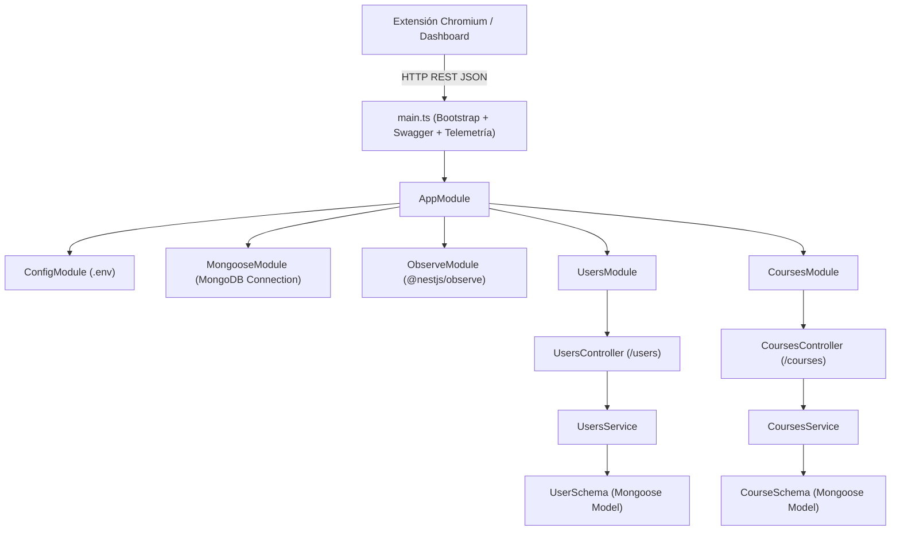

# Arquitectura Técnica de Backend y API REST (sicoco-framework)

**Proyecto:** SICOCO (Sintetizador de Co-creación Colaborativa)  
**Módulo:** Framework de Backend y Capa de Persistencia (`sicoco-framework`)  
**Asignatura:** 203453 · Diseño y Desarrollo de Software Educativo II · Semestre IX  
**Periodo:** 2026-2 · Universidad de Córdoba  

---

## 1. Visión General del Framework de Backend

Durante el **9no semestre**, el proyecto SICOCO trascendió formalmente la fase de diseño y planificación teórica (Fases 1 a 3 de MODESEC) para dar inicio a la **Fase 4: Producción y Desarrollo**.

Para garantizar un backend robusto, escalable, tipado y mantenible, se estructuró la solución sobre el framework **NestJS** en su versión más moderna (v12), utilizando **TypeScript** con arquitectura nativa de módulos ECMAScript (`"type": "module"`). La persistencia de datos se apoya en **MongoDB** a través de **Mongoose**, implementando una arquitectura de capas con separación estricta de responsabilidades: Controladores, Servicios, Objetos de Transferencia de Datos (DTOs) y Esquemas de Datos.



---

## 2. Stack Tecnológico y Dependencias Principales

La arquitectura técnica se encuentra configurada en el archivo `package.json` de `sicoco-framework`:

| Categoría | Tecnología / Librería | Versión | Propósito en el Proyecto |
| :--- | :--- | :---: | :--- |
| **Framework Base** | `@nestjs/core`, `@nestjs/common` | `^12.0.1` | Arquitectura empresarial modular con inyección de dependencias e inversión de control. |
| **Plataforma HTTP** | `@nestjs/platform-express` | `^12.0.1` | Motor de enrutamiento y procesamiento de peticiones HTTP REST. |
| **Persistencia NoSQL** | `@nestjs/mongoose`, `mongoose` | `^12.0.0` / `^9.11.4` | Modelado y persistencia orientada a documentos para gestión flexible de entidades y mensajes. |
| **Configuración** | `@nestjs/config` | `^12.0.1` | Carga asíncrona de variables de entorno desde `.env` con soporte global. |
| **Documentación API** | `@nestjs/swagger` | `^12.1.0` | Generación automática de especificaciones OpenAPI y UI interactiva en tiempo real. |
| **Observabilidad** | `@nestjs/observe` | `^0.3.0` | Instrumentación, métricas y telemetría de rendimiento del servidor. |
| **Testing** | `vitest`, `@nestjs/testing` | `^4.1.2` / `^12.0.1` | Suite de pruebas unitarias ultrarrápida basada en Vite con soporte nativo de ESM. |
| **E2E Testing** | `supertest` | `^7.0.0` | Ejecución de pruebas de integración extremo a extremo contra los endpoints REST. |
| **Linting y Calidad** | `oxlint`, `oxlint-tsgolint` | `^1.58.0` | Linter de alto rendimiento basado en Rust con análisis de tipos TypeScript. |
| **Formateo de Código** | `prettier` | `^3.4.2` | Estandarización de estilo de código en todo el repositorio. |

---

## 3. Justificación de la Estrategia de Persistencia (MongoDB & Mongoose)

Si bien en el primer semestre se diseñó un Modelo Entidad-Relación relacional de 19 tablas, el equipo determinó en la **Validación Técnica U1-01** que las características operativas de SICOCO requerían un esquema híbrido y escalable:

1. **Naturaleza Jerárquica y Semi-estructurada de los Chats:** Las transcripciones de mensajería (WhatsApp, Discord, Teams) contienen una estructura arbórea con hilos de respuestas, reacciones, metadatos variables y textos de longitud impredecible. Los esquemas basados en documentos JSON/BSON de MongoDB permiten almacenar estos bloques de mensajes sin sobrecargar un motor SQL con cientos de miles de filas fragmentadas.
2. **Velocidad de Iteración en Fase 4:** Mongoose proporciona validación estricta de esquemas, tipos y restricciones en tiempo de compilación y ejecución, facilitando adaptar los esquemas conforme evolucionan los requerimientos pedagógicos de MODESEC sin requerir migraciones complejas de base de datos relacional.
3. **Mapeo Limpio de Entidades Académicas:** Entidades como Usuarios y Cursos se definen con decoradores `@Schema()` y `@Prop()`, garantizando unicidad en correos institucionales y códigos de materia.

---

## 4. Estructura de Módulos y Código Fuente

El código se encuentra organizado dentro de la carpeta `src/`:

```
src/
├── app.controller.spec.ts       # Pruebas del controlador raíz
├── app.controller.ts            # Controlador base
├── app.module.ts                # Módulo raíz de la aplicación
├── app.service.ts               # Servicio base
├── main.ts                      # Punto de entrada y configuración de Swagger
├── courses/                     # Módulo de Gestión de Cursos Académicos
│   ├── dto/
│   │   ├── create-course.dto.ts # DTO para creación de curso
│   │   └── update-course.dto.ts # DTO para actualización parcial
│   ├── schemas/
│   │   └── course.schema.ts     # Esquema Mongoose de la colección 'courses'
│   ├── courses.controller.spec.ts
│   ├── courses.controller.ts    # Controlador REST de Cursos
│   ├── courses.module.ts        # Módulo de Cursos
│   ├── courses.service.spec.ts
│   └── courses.service.ts       # Lógica de negocio y persistencia
└── users/                       # Módulo de Gestión de Usuarios
    ├── dto/
    │   ├── create-user.dto.ts   # DTO para creación de usuario
    │   └── update-user.dto.ts   # DTO para actualización parcial
    ├── entities/
    │   └── user.entity.ts       # Entidad de dominio
    ├── schemas/
    │   └── user.schema.ts       # Esquema Mongoose de la colección 'users'
    ├── users.controller.spec.ts
    ├── users.controller.ts      # Controlador REST de Usuarios
    ├── users.module.ts          # Módulo de Usuarios
    ├── users.service.spec.ts
    └── users.service.ts         # Lógica de negocio y persistencia
```

### 4.1. Configuración de Inicio y Swagger (`main.ts`)
El servidor inicializa la aplicación NestJS integrando el instrumento de telemetría `@nestjs/observe` y expone la documentación OpenAPI Swagger en la ruta `/api`:

```typescript
import { NestFactory } from '@nestjs/core';
import { SwaggerModule, DocumentBuilder } from '@nestjs/swagger';
import { AppModule, ObserveInstrument } from './app.module.js';

async function bootstrap() {
  const app = await NestFactory.create(AppModule, {
    instrument: ObserveInstrument,
  });

  const config = new DocumentBuilder()
    .setTitle('Sicoco API')
    .setDescription('API documentation for Sicoco')
    .setVersion('1.0')
    .addTag('users')
    .addTag('courses')
    .build();
    
  const documentFactory = () => SwaggerModule.createDocument(app, config);
  SwaggerModule.setup('api', app, documentFactory);

  await app.listen(process.env.PORT ?? 3000);
}
await bootstrap();
```

### 4.2. Módulo de Usuarios (`UsersModule`)
- **Esquema de Datos (`user.schema.ts`):** Define el usuario con campos `name` (requerido), `email` (requerido y único) y `age` (opcional), con marcas temporales automáticas (`timestamps: true`).
- **Operaciones REST expuestas (`users.controller.ts`):**
  - `POST /users`: Registra un nuevo usuario en la base de datos a partir del DTO.
  - `GET /users`: Consulta y retorna la lista completa de usuarios registrados.
  - `GET /users/:id`: Busca un usuario específico mediante su identificador único de MongoDB (`_id`).
  - `PATCH /users/:id`: Aplica modificaciones parciales a los datos del usuario.
  - `DELETE /users/:id`: Elimina el registro del usuario.

### 4.3. Módulo de Cursos (`CoursesModule`)
- **Esquema de Datos (`course.schema.ts`):** Vinculado a la colección `'courses'`, modela la asignatura académica con los atributos:
  - `code` (cadena única, requerida y limpia de espacios).
  - `name` (nombre de la materia, requerido).
  - `academicSemester` (semestre académico, ej. `"2026-2"`, requerido).
  - `instructor` (docente a cargo de la materia).
  - `description` (descripción u objetivos de la asignatura).
  - `isActive` (estado booleano, por defecto `true`).
  - `timestamps` automáticos de creación y actualización.
- **Operaciones REST expuestas (`courses.controller.ts`):**
  - `POST /courses`: Crea una nueva materia académica.
  - `GET /courses`: Lista todas las materias creadas.
  - `GET /courses/:id`: Obtiene la información detallada de una asignatura.
  - `PATCH /courses/:id`: Actualiza datos de la materia (docente, estado, etc.).
  - `DELETE /courses/:id`: Elimina la asignatura.

---

## 5. Estrategia de Pruebas Automatizadas y Calidad

Para superar las limitaciones de rendimiento del runner Jest tradicional, el proyecto implementó **Vitest v4.1.2** configurado con soporte nativo para ES Modules y TypeScript:

### 5.1. Pruebas Unitarias (`*.spec.ts`)
Cada servicio y controlador cuenta con su archivo de pruebas unitarias aislado utilizando mocks de Mongoose mediante `@nestjs/testing` y `getModelToken()`:
- `users.controller.spec.ts` y `users.service.spec.ts`
- `courses.controller.spec.ts` y `courses.service.spec.ts`
- `app.controller.spec.ts`

### 5.2. Pruebas de Integración y E2E (`vitest.config.e2e.ts`)
Configurado para ejecutar pruebas de integración completas mediante `supertest`, validando que la aplicación responda a solicitudes HTTP reales en `test/app.e2e-spec.ts`.

### 5.3. Pipeline de Comandos
El equipo dispone de scripts automatizados en `package.json`:
- `npm run start:dev`: Levanta el servidor con recarga en caliente (`watch`) y variables desde `.env`.
- `npm run build`: Compila el proyecto TypeScript a la carpeta `dist/`.
- `npm run test`: Ejecuta la suite de pruebas unitarias con Vitest.
- `npm run test:e2e`: Ejecuta las pruebas de extremo a extremo.
- `npm run lint`: Ejecuta el linter ultrarrápido `oxlint` con validación estricta de tipos.
- `npm run format`: Aplica formateo consistente con Prettier en `src/` y `test/`.

---

## 6. Siguientes Pasos de Implementación Backend

Con los módulos fundacionales de usuarios y cursos operativos, el roadmap técnico contempla para las siguientes semanas:
1. **Módulo de Sesiones e Ingesta (`SessionsModule`):** Endpoint receptor de los payloads de chat extraídos por la extensión de navegador Chromium.
2. **Servicio de IA y Prompts (`AiModule`):** Cliente de conexión a la API de Google Gemini / OpenAI para ejecutar la ingeniería de prompts y extraer los cuatro pilares (Acuerdos, Desacuerdos, Dudas, Tareas).
3. **Mecanismo de Procesamiento Asíncrono:** Implementación de cola de trabajos (`Job_ID`) para garantizar que la inferencia de lenguaje no genere timeouts en las peticiones web.
