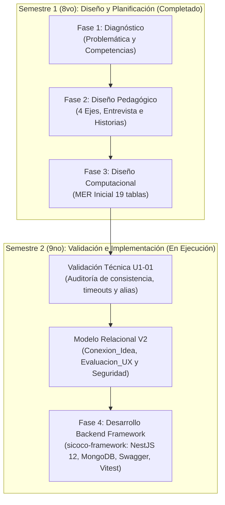

# Guía de Estudio y Avances de SICOCO (Semestre IX)

## Evolución, Colaboración y Estado del Proyecto (Validación Técnica y Desarrollo de Backend)

Este documento sirve como resumen ejecutivo y guion de estudio para presentar los avances consolidados del proyecto **SICOCO** (*Sintetizador de Co-creación Colaborativa*) durante el **9no semestre** (asignatura **Diseño y Desarrollo de Software Educativo II**). Explica la transición desde la fase de planeación teórica (Semestre I) hacia la **construcción física y validación de ingeniería del software** (Semestre II), detallando los hitos alcanzados, la división del trabajo y el estado actual del prototipo.

---

## 1. Cronología y Evolución del Proyecto

Mientras que el 8vo semestre se limitó exclusivamente al diseño pedagógico y modelado conceptual bajo el modelo **MODESEC**, el 9no semestre ejecutó la **validación técnica formal** e inició formalmente la **Fase 4: Producción y Desarrollo**.

---

## 2. Tabla Maestra de Hitos de Documentación (Estructura en Inglés)

A continuación se presenta el catálogo completo de la documentación del proyecto SICOCO, con la nomenclatura unificada en inglés:

| Archivo | Fase / Tema | Contenido Clave Detallado |
| :--- | :--- | :--- |
| **`00_base_document.md`** | General / Introducción | Contexto académico ampliado (8vo y 9no semestre), diagnóstico de sobrecarga, objetivos, fundamentación pedagógica y síntesis de avances. |
| **`01_diagnosis.md`** | Fase 1: Diagnóstico | Delimitación del problema de sobrecarga y definición del perfil de usuario y meta del sistema. |
| **`02_pedagogical_design.md`** | Fase 2: Diseño Pedagógico | Estructura de análisis en 4 ejes (Acuerdos, Desacuerdos, Tareas, Dudas) y mapa de la co-creación. |
| **`03_computational_design.md`** | Fase 3: Diseño Computacional | Especificación técnica del MVP como extensión Chromium y consumo de APIs de IA. |
| **`04_production_and_development.md`** | Fase 4: Producción y Desarrollo | Lineamientos actualizados de desarrollo del frontend y backend en NestJS. |
| **`05_evaluation.md`** | Fase 5: Evaluación | Metodología de validación en campo: precisión técnica, usabilidad y utilidad formativa. |
| **`06_implementation_and_monitoring.md`** | Fase 6: Implementación | Planificación del programa piloto en la Universidad de Córdoba y mantenimiento evolutivo. |
| **`07_data_architecture_interview_og.md`** | Requerimientos Originales | Registro preliminar de respuestas de datos crudos para las 19 tablas iniciales. |
| **`07A_interview_questions.md`** | Requerimientos (Preguntas) | Cuestionario estructurado de 20 preguntas con el Arquitecto de Datos Senior. |
| **`07B_interview_answers.md`** | Requerimientos (Respuestas) | Respuestas técnicas detalladas para la modelación de entidades y relaciones. |
| **`08_user_stories.md`** | Requisitos Funcionales | Matriz de historias de usuario ordenadas en 5 zonas con criterios de aceptación en formato Gherkin. |
| **`09_methodological_foundation.md`** | Fundamentación Pedagógica | Marco metodológico MODESEC, taxonomías de aprendizaje y enfoque de co-creación. |
| **`10_entity_relationship_model.md`** | Diseño de Base de Datos V1 | Definición inicial de las 19 tablas relacionales en código DBML y SQL. |
| **`11_interview_model_comparison.md`** | Trazabilidad de Datos | Matriz de correspondencia entre las preguntas de la entrevista y las entidades del modelo. |
| **`12_technical_development.md`** | Especificación Técnica MVP | Arquitectura de componentes, flujos críticos, seguridad y requerimientos no funcionales. |
| **`13_first_semester_scope.md`** | Cierre Semestre 1 (8vo) | Alcance inicial que certifica el cierre de la etapa de diseño teórico sin código ejecutable. |
| **`14_technical_design_validation.md`** *(NUEVO)* | Validación Técnica U1-01 | Auditoría de inconsistencias del diseño recibido, mitigación de timeouts en IA y mapeo de alias. |
| **`15_entity_relationship_model_v2.md`** *(NUEVO)* | Modelo Relacional V2 | Esquema mejorado con `Conexion_Idea`, `Evaluacion_UX`, `Configuracion_Prompt` vinculada y banderas de privacidad. |
| **`16_backend_architecture_and_api.md`** *(NUEVO)* | Arquitectura Backend | Documentación del framework de backend (`sicoco-framework`): NestJS 12, MongoDB/Mongoose, Swagger y Vitest. |
| **`17_second_semester_scope.md`** *(NUEVO)* | Cierre y Avances Semestre 2 (9no) | Síntesis ejecutiva de la evolución técnica y paso a prototipo programado en el 9no semestre. |

---

## 3. Principales Avances Alcanzados este Semestre

### Hito 1: Validación Técnica e Informe U1-01
- Auditoría profunda del diseño preliminar recibido.
- Identificación de riesgos computacionales severos: caídas por *HTTP Timeout* en la inferencia sincrónica de LLMs y desconexión entre los nombres de WhatsApp y la matrícula de los alumnos.
- Formulación de soluciones técnicas justificadas frente a alternativas descartadas: arquitectura asíncrona mediante colas de trabajo (`Job_ID`), catálogo de homologación de apodos (`Alias_Estudiante`) y automatización de estados de tareas mediante *Cron Jobs*.
- Coevaluación cruzada con proyectos pares del curso (como EDUQUEST y PROMETEO).

### Hito 2: Refinamiento del Modelo de Datos a Versión 2 (V2)
- Integración de la entidad reflexiva `Conexion_Idea` (auto-relación de `Momento_Clave_Chat`), permitiendo graficar cómo las ideas se encadenan e inspiran mutuamente.
- Incorporación de `Evaluacion_UX` para registrar encuestas de claridad de interfaz.
- Inclusión de atributos de seguridad: `Es_Confidencial` en `Registro_Chat` y `Requiere_Aprobacion_Profesor` en `Equipo`.
- Conexión formal de clave foránea entre `Resumen_Generado` y `Configuracion_Prompt` (`ID_Configuracion`).
- Exportación del nuevo diagrama relacional (`SICOCO v2.png` y `diagrama_bd_v2.dbml`).

### Hito 3: Construcción Física del Backend (`sicoco-framework`)
A diferencia del semestre anterior, **SICOCO ya cuenta con una plataforma de software backend funcional y programada con 6 módulos operacionales**:
- **Framework Empresarial:** Implementación de NestJS 12 con TypeScript moderno y módulos ES (`"type": "module"`).
- **Capa de Persistencia NoSQL:** Conexión asíncrona a MongoDB mediante Mongoose 9, modelando esquemas y DTOs estructurados.
- **Cobertura Completa de Zonas MODESEC:**
  - **Zona 1 (Organización Académica):** `UsersModule` (`/users`), `CoursesModule` (`/courses`) y `TeamsModule` (`/teams` con subdocumentos `TeamMember` y roles).
  - **Zona 2 (Sesiones e Ingesta):** `SessionsModule` (`/sessions` con plataformas y estados) y `TranscriptsModule` (`/transcripts` con subdocumentos `ChatMessage` y endpoint de ingesta masiva `/transcripts/:id/messages`).
  - **Zonas 3 y 4 (Síntesis y Co-creación):** `SummariesModule` (`/summaries`) implementando la estructura completa de los 4 pilares (Acuerdos, Desacuerdos, Dudas, Tareas), la relación reflexiva `Conexion_Idea` en la línea de tiempo (`inspiredByMomentId`) y el flujo asíncrono anti-timeout con `jobId` (`POST /summaries/generate` -> `GET /summaries/job/:jobId`).
- **Documentación Interactiva Automática:** OpenAPI Swagger desplegado en `/api` con etiquetas organizadas para los 6 módulos.
- **Testing y Calidad de Código:** Adopción de Vite y Vitest v4.1.2 ejecutando **13 suites de pruebas unitarias (`*.spec.ts`) con 100% de aprobación** y pruebas de extremo a extremo (`test/app.e2e-spec.ts`) con supertest.
- **Observabilidad:** Integración del módulo de telemetría `@nestjs/observe`.

---

## 4. División del Trabajo: ¿Quién hizo qué?

### Aportes de la Inteligencia Artificial (Antigravity)
* **Auditoría de Inconsistencias:** Análisis de esquemas para detectar claves foráneas faltantes y riesgos de concurrencia.
* **Generación de Código Base de Backend:** Andamiaje de controladores, servicios, DTOs y esquemas en NestJS 12 y Mongoose para los 6 módulos (`Users`, `Courses`, `Teams`, `Sessions`, `Transcripts`, `Summaries`).
* **Implementación del Flujo Asíncrono de Inferencia:** Creación del mecanismo de polling por `jobId` para erradicar el riesgo de HTTP Timeout identificado en el informe U1-01.
* **Estandarización de Pruebas:** Migración y configuración de Vitest con 13 suites unitarias y pruebas E2E con mocks de Mongoose.
* **Unificación de Documentación:** Traducción técnica de nomenclatura de archivos al inglés y trazabilidad cruzada.

### Aportes del Equipo de Trabajo (SICOCO Dev Team)
* **Definición de Lógica de Negocio y Criterios Académicos:** Ajuste de los formatos U1-01 a los lineamientos del docente Alexander Enrique Toscano Ricardo.
* **Evaluación Crítica de Decisiones:** Debate y descarte de alternativas en la auditoría técnica (rechazo de la modificación obligatoria de nombres en WhatsApp para preservar la usabilidad).
* **Validación de Datos Académicos:** Especificación de los modelos de Cursos, Equipos y Estudiantes para su correspondencia con los planes de estudio de la Universidad de Córdoba.
* **Verificación de los Cuatro Pilares:** Definición de los campos esenciales para Acuerdos, Desacuerdos, Dudas, Tareas y Línea de Tiempo colaborativa.
* **Configuración de Entorno Local y Pruebas:** Validación de dependencias Node.js, variables de entorno en `.env` y revisión visual de la interfaz de Swagger.

---

## 5. Estado Actual del Proyecto y Próximos Pasos

El proyecto SICOCO ha alcanzado con éxito el estado de **backend completo y operativo con 6 módulos funcionales**:
1. **Infraestructura lista:** El servidor NestJS compila de forma nativa, expone contratos en Swagger OpenAPI (`/api`), almacena y consulta datos en MongoDB y aprueba 13 suites de pruebas automatizadas.
2. **Próximos entregables del MVP:**
   - Conexión del scraper de la extensión Chromium al endpoint `POST /transcripts/:id/messages`.
   - Conexión de `SummariesService.generate()` con la API de Google Gemini inyectando los prompts pedagógicos de MODESEC.
   - Ensamble visual de los componentes de la interfaz de usuario del Dashboard.
