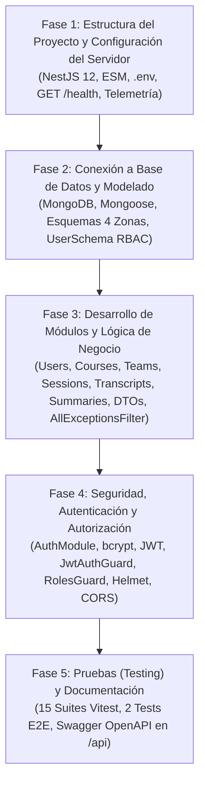

# Plan de Trabajo Oficial: Desarrollo del Backend de SICOCO (Fases 1 a 5)

**Proyecto:** SICOCO (Sintetizador de Co-creación Colaborativa)  
**Asignatura:** Diseño y Desarrollo de Software Educativo II (Código 203453) · Semestre IX  
**Docente Director:** Mg. Alexander Enrique Toscano Ricardo  
**Institución:** Universidad de Córdoba · Facultad de Educación y Ciencias Humanas · Licenciatura en Informática  
**Equipo Desarrollador:**  
- José Daniel Durango Caballero  
- Jefersson Ramírez Oviedo  
- Jesús Daniel Ruiz Román  
- Jeyson David López Gorrostola  
**Fecha de Publicación:** Noviembre de 2026  
**Repositorio Oficial:** [https://github.com/JoseDanielDurango/SICOCO-Project](https://github.com/JoseDanielDurango/SICOCO-Project)  

---

## 1. Justificación y Objetivos del Plan de Trabajo

El presente **Plan de Trabajo** formaliza la hoja de ruta metodológica y técnica para la implementación del backend de la plataforma **SICOCO** (*sicoco-framework*), dando estricto cumplimiento a la estructura por fases requerida en la cátedra de *Diseño y Desarrollo de Software Educativo II* bajo la metodología **MODESEC** (Modelo de Organización de Estrategias para el Desarrollo de Software Educativo por Competencias).

### 1.1. Objetivo General
Diseñar, implementar, asegurar y verificar un backend robusto, modular y escalable en **NestJS 12** y **MongoDB**, que dé soporte a las cuatro zonas de datos del modelo MODESEC para el procesamiento de conversaciones grupales, extracción pedagógica de los cuatro pilares (Acuerdos, Desacuerdos, Dudas y Tareas) y visualización del grafo de co-creación (`Conexion_Idea`), garantizando seguridad mediante JWT y control de acceso basado en roles (RBAC).

### 1.2. Ficha Técnica del Stack Tecnológico
* **Lenguaje:** TypeScript 6.0 (Arquitectura ECMAScript Modules `"type": "module"`).
* **Framework Backend:** NestJS 12.0.1 (Arquitectura en capas desacopladas con Inversión de Control e Inyección de Dependencias).
* **Base de Datos NoSQL:** MongoDB 9.0 con ODM Mongoose 9.11.4.
* **Seguridad y Criptografía:** `bcryptjs` (salt 10), `@nestjs/jwt` (firmado asíncrono con vigencia de 24h) y `helmet`.
* **Validación de Datos:** `class-validator` y `class-transformer` con `ValidationPipe` global.
* **Motor de Pruebas:** Vitest 4.1.2 para pruebas unitarias (`*.spec.ts`) y Supertest para pruebas E2E.
* **Documentación Interactiva:** OpenAPI 3.0 / Swagger UI en la ruta `/api` con autorización Bearer JWT.

---

## 2. Estructura del Plan de Trabajo por Fases (Metodología de 5 Fases)

---

### Fase 1: Estructura del Proyecto y Configuración del Servidor

#### Objetivo
Establecer la estructura física del repositorio backend, configurar el entorno de ejecución modular en TypeScript ESM, definir las variables de entorno centralizadas y habilitar el punto de entrada con comprobación de salud operativa.

#### Tareas del Plan
1. Inicializar la estructura modular de directorios bajo buenas prácticas de NestJS en `src/`.
2. Configurar el archivo de arranque [`main.ts`](file:///c:/Me,%20Myself%20and%20I/Unicordoba/SICOCO%20-%20Project/sicoco-framework/src/main.ts) con soporte para telemetría `@nestjs/observe`.
3. Crear el archivo de plantilla de variables de entorno [`.env.example`](file:///c:/Me,%20Myself%20and%20I/Unicordoba/SICOCO%20-%20Project/sicoco-framework/.env.example) declarando `PORT`, `MONGODB_URI`, `JWT_SECRET`, `JWT_EXPIRES_IN`, `OBSERVE_APP_KEY`.
4. Implementar el endpoint de prueba y diagnóstico [`GET /health`](file:///c:/Me,%20Myself%20and%20I/Unicordoba/SICOCO%20-%20Project/sicoco-framework/src/app.controller.ts) que retorne estado del servicio, uptime del proceso, hora ISO y entorno.
5. Mantener el endpoint raíz de verificación de conectividad HTTP [`GET /`](file:///c:/Me,%20Myself%20and%20I/Unicordoba/SICOCO%20-%20Project/sicoco-framework/src/app.controller.ts).

#### Entregables Verificables
- Archivos: `package.json`, `tsconfig.json`, `nest-cli.json`, `.env.example`, `src/main.ts`, `src/app.module.ts`, `src/app.controller.ts`, `src/app.service.ts`.
- Endpoint funcional: `http://localhost:3000/health`.

#### Criterio de Aceptación
El servidor debe arrancar limpiamente mediante `npm run start:dev`, cargar las variables de `.env` y responder exitosamente con código HTTP 200 en `/health`.

---

### Fase 2: Conexión a Base de Datos y Modelado de Datos

#### Objetivo
Garantizar la conexión persistente con MongoDB mediante Mongoose, administrando el pool de conexiones y modelando los esquemas orientados a documentos que representan las 19 entidades del modelo relacional V2 de SICOCO.

#### Tareas del Plan
1. Configurar `MongooseModule.forRootAsync` en `AppModule` con inyección de `ConfigService` para lectura segura de `MONGODB_URI`.
2. Modelar el esquema ampliado [`UserSchema`](file:///c:/Me,%20Myself%20and%20I/Unicordoba/SICOCO%20-%20Project/sicoco-framework/src/users/schemas/user.schema.ts) con soporte de credenciales seguras (`password` con exclusión `select: false`), roles (`role`: `'student' | 'teacher' | 'admin'`), código de matrícula (`enrollmentNumber`), programa académico y semestre.
3. Modelar los esquemas de la **Zona 1 (Organización Académica)**: `CourseSchema` y `TeamSchema` con colección de subdocumentos embebidos `TeamMember` (roles de líder, miembro, invitado).
4. Modelar los esquemas de la **Zona 2 (Sesiones e Ingesta)**: `SessionSchema` (fechas, objetivos, plataformas origen) y `TranscriptSchema` con jerarquía de subdocumentos `ChatMessage` (remitentes, alias, marcas temporales y contenido).
5. Modelar los esquemas de las **Zonas 3 y 4 (Síntesis MODESEC y Co-creación)**: `SummarySchema` con subdocumentos para los 4 pilares (`agreements`, `disagreements`, `doubts`, `tasks`) y la línea de tiempo reflexiva (`timeline` con soporte de auto-relación `Conexion_Idea` vía `inspiredByMomentId`).

#### Entregables Verificables
- Esquemas Mongoose compilados en TypeScript: `user.schema.ts`, `course.schema.ts`, `team.schema.ts`, `session.schema.ts`, `transcript.schema.ts`, `summary.schema.ts`.

#### Criterio de Aceptación
Conexión asíncrona validada a MongoDB, índices únicos configurados en correos y códigos de materia, y persistencia correcta de subdocumentos embebidos sin pérdida de relaciones foráneas.

---

### Fase 3: Desarrollo de Módulos y Lógica de Negocio

#### Objetivo
Construir los controladores y servicios REST para cada entidad del sistema, implementando validación estricta de datos de entrada y manejo global de excepciones con códigos de estado HTTP estandarizados.

#### Tareas del Plan
1. **Separación estricta de capas:** Cada módulo debe contener Controlador (`*.controller.ts`), Servicio de negocio (`*.service.ts`), Objetos de Transferencia de Datos (`dto/*.dto.ts`) y Esquema Mongoose (`schemas/*.schema.ts`).
2. **Implementación de los 6 Módulos Operativos:**
   - **`UsersModule` (`/users`):** Operaciones CRUD de usuarios.
   - **`CoursesModule` (`/courses`):** Asignaturas y materias académicas.
   - **`TeamsModule` (`/teams`):** Equipos de trabajo con endpoints especializados para anexar y desvincular miembros (`POST /teams/:id/members`, `DELETE /teams/:id/members/:studentId`).
   - **`SessionsModule` (`/sessions`):** Sesiones grupales y estados de reunión.
   - **`TranscriptsModule` (`/transcripts`):** Ingesta individual y masiva de mensajes extraídos por el scraper DOM (`POST /transcripts/:id/messages`).
   - **`SummariesModule` (`/summaries`):** Motor de síntesis MODESEC. Incluye la solución al riesgo de timeout reportado en el informe técnico U1-01 mediante procesamiento asíncrono (`POST /summaries/generate` retorna un `jobId` UUID inmediato con código HTTP 202, y `GET /summaries/job/:jobId` permite sondeo periódico).
3. **Validación de Datos de Entrada:** Decorar todos los DTOs con `class-validator` (`@IsString`, `@IsEmail`, `@MinLength`, etc.) y activar `ValidationPipe({ whitelist: true, transform: true })` global en `main.ts`.
4. **Filtro Global de Excepciones:** Crear [`AllExceptionsFilter`](file:///c:/Me,%20Myself%20and%20I/Unicordoba/SICOCO%20-%20Project/sicoco-framework/src/common/filters/http-exception.filter.ts) para capturar cualquier excepción HTTP o interna, retornando respuestas estructuradas en formato JSON `{ statusCode, timestamp, path, method, message, error }`.

#### Entregables Verificables
- Controladores y servicios de `users`, `courses`, `teams`, `sessions`, `transcripts` y `summaries`.
- Archivo `src/common/filters/http-exception.filter.ts`.

#### Criterio de Aceptación
Toda petición con payload malformado debe ser rechazada con código HTTP 400 Bad Request detallando los campos erróneos, y los errores no controlados deben registrarse en consola retornando un código 500 controlado sin exponer trazas de memoria al cliente.

---

### Fase 4: Seguridad, Autenticación y Autorización

#### Objetivo
Implementar un sistema integral de seguridad perimetral, autenticación basada en JSON Web Tokens (JWT), encriptación unidireccional de contraseñas, control de acceso basado en roles (RBAC) y cabeceras de seguridad HTTP.

#### Tareas del Plan
1. **Módulo de Autenticación ([`AuthModule`](file:///c:/Me,%20Myself%20and%20I/Unicordoba/SICOCO%20-%20Project/sicoco-framework/src/auth/auth.module.ts)):**
   - Implementar `POST /auth/register` con verificación de correo duplicado y cifrado de clave usando `bcryptjs` con 10 rondas de salt.
   - Implementar `POST /auth/login` validando contraseñas mediante `bcryptjs.compare` y generando un token JWT firmado de 24 horas conteniendo `sub`, `email`, `role` y `name`.
   - Implementar `GET /auth/profile` que retorne la identidad del usuario a partir del token JWT.
2. **Guardia de Autenticación ([`JwtAuthGuard`](file:///c:/Me,%20Myself%20and%20I/Unicordoba/SICOCO%20-%20Project/sicoco-framework/src/auth/guards/jwt-auth.guard.ts)):**
   - Interceptar solicitudes HTTP, extraer el token del header `Authorization: Bearer <token>`, verificar su firma e inyectar el usuario en `request.user`.
   - Permitir exclusión de rutas mediante el decorador [`@Public()`](file:///c:/Me,%20Myself%20and%20I/Unicordoba/SICOCO%20-%20Project/sicoco-framework/src/auth/decorators/public.decorator.ts).
3. **Control de Acceso Basado en Roles ([`RolesGuard`](file:///c:/Me,%20Myself%20and%20I/Unicordoba/SICOCO%20-%20Project/sicoco-framework/src/auth/guards/roles.guard.ts)):**
   - Crear el decorador declarativo [`@Roles('teacher', 'admin')`](file:///c:/Me,%20Myself%20and%20I/Unicordoba/SICOCO%20-%20Project/sicoco-framework/src/auth/decorators/roles.decorator.ts).
   - Bloquear con código HTTP 403 Forbidden a cualquier usuario cuyo rol no coincida con los permisos requeridos por el endpoint (ej. `GET /auth/teacher-only`).
4. **Seguridad HTTP:**
   - Inyectar el middleware `helmet()` en `main.ts` para mitigar ataques XSS, Clickjacking y Sniffing de MIME types.
   - Habilitar `cors({ origin: '*', credentials: true })` para autorizar las conexiones originadas desde la extensión web Chromium y el Dashboard de visualización.

#### Entregables Verificables
- Código fuente en `src/auth/` (`auth.controller.ts`, `auth.service.ts`, `auth.module.ts`, guardias y decoradores).
- Dependencias instaladas: `@nestjs/jwt`, `bcryptjs`, `@types/bcryptjs`, `helmet`.

#### Criterio de Aceptación
Las contraseñas nunca deben guardarse en texto plano. Los endpoints protegidos deben rechazar solicitudes sin token con código 401 Unauthorized y peticiones con rol no autorizado con código 403 Forbidden.

---

### Fase 5: Pruebas (Testing) y Documentación de la API

#### Objetivo
Certificar la calidad, estabilidad y cobertura del backend mediante pruebas automatizadas (unitarias y de integración) y publicar la especificación interactiva OpenAPI en Swagger UI.

#### Tareas del Plan
1. **Pruebas Unitarias con Vitest:**
   - Crear archivos `*.spec.ts` para todos los controladores y servicios del backend utilizando mocks aislados de Mongoose (`getModelToken`) y `JwtService`.
   - Cubrir: `AppController`, `AuthService`, `AuthController`, `UsersService`, `UsersController`, `CoursesService`, `CoursesController`, `TeamsService`, `TeamsController`, `SessionsService`, `SessionsController`, `TranscriptsService`, `TranscriptsController`, `SummariesService`, `SummariesController`.
2. **Pruebas de Integración Extremo a Extremo (E2E):**
   - Configurar `vitest.config.e2e.ts` con `supertest`.
   - Validar en [`test/app.e2e-spec.ts`](file:///c:/Me,%20Myself%20and%20I/Unicordoba/SICOCO%20-%20Project/sicoco-framework/test/app.e2e-spec.ts) la respuesta HTTP 200 de los endpoints `GET /` y `GET /health`.
3. **Documentación Swagger / OpenAPI 3.0:**
   - Configurar `DocumentBuilder` en `main.ts` con soporte para autorización Bearer (`addBearerAuth()`).
   - Categorizar la totalidad de los 41 endpoints del sistema bajo las etiquetas: `health`, `auth`, `users`, `courses`, `teams`, `sessions`, `transcripts` y `summaries`.

#### Entregables Verificables
- 15 suites de pruebas unitarias (`*.spec.ts`) y suite E2E en `test/app.e2e-spec.ts`.
- Consola Swagger desplegada dinámicamente en: `http://localhost:3000/api`.

#### Criterio de Aceptación
Ejecución limpia del 100% de las pruebas (`npm test` y `npm run test:e2e`) con 0 fallos, y visualización completa de los esquemas y botones interactivos de prueba en la interfaz Swagger.

---

## 3. Matriz de Responsabilidades del Equipo (Matriz RACI)

**Roles:**
* **R (Responsible):** Quien ejecuta directamente la tarea.
* **A (Accountable):** Quien supervisa y aprueba el entregable.
* **C (Consulted):** Quien aporta insumos técnicos o metodológicos.
* **I (Informed):** Quien se mantiene actualizado del avance.

| Actividad / Hito del Plan de Trabajo | José Daniel Durango | Jefersson Ramírez | Jesús Daniel Ruiz | Jeyson David López |
| :--- | :---: | :---: | :---: | :---: |
| **Fase 1: Bootstrap de NestJS, ESM y `/health`** | **A / R** | **C** | **I** | **I** |
| **Fase 2: Conexión MongoDB y Modelado Mongoose V2** | **A** | **R** | **C** | **I** |
| **Fase 3: Módulos Académicos (Users, Courses, Teams)** | **C** | **A / R** | **C** | **I** |
| **Fase 3: Ingesta y MODESEC (Sessions, Transcripts, Summaries)** | **A / R** | **C** | **R** | **C** |
| **Fase 3: Validación DTOs y AllExceptionsFilter** | **R** | **C** | **A** | **I** |
| **Fase 4: Módulo Auth, Encriptación bcrypt y Tokens JWT** | **A / R** | **C** | **C** | **R** |
| **Fase 4: Guardias RBAC (@Roles) y Seguridad HTTP (Helmet, CORS)** | **R** | **A** | **C** | **R** |
| **Fase 5: Pruebas Unitarias Vitest y Pruebas E2E Supertest** | **A** | **R** | **A / R** | **C** |
| **Fase 5: Especificación OpenAPI y Consola Swagger /api** | **C** | **I** | **R** | **A / R** |
| **Gestión Documental y Sincronización en GitHub** | **A / R** | **C** | **C** | **C** |

---

## 4. Cronograma de Hitos, Sprints y Estado de Cumplimiento Progresivo

El plan de trabajo se distribuye a lo largo del periodo académico en **5 Sprints iterativos**. Conforme a las instrucciones del docente sobre entregas incrementales y validación paso a paso, el estado actual de avance del proyecto se resume en la siguiente tabla:

| Hito / Sprint | Fase del Modelo | Periodo Estimado | Entregables Principales | Estado Actual | Observaciones / Próxima Validación |
| :---: | :---: | :---: | :--- | :---: | :--- |
| **Sprint 1 (H1)** | **Fase 1** | Semanas 1 – 3 | Servidor base NestJS 12, TypeScript ESM, variables `.env.example`, endpoint `GET /health` y telemetría. | **100% Completado** | Servidor verificado y disponible en puerto 3000 con respuesta 200 en `/health`. |
| **Sprint 2 (H2)** | **Fase 2** | Semanas 4 – 6 | Conexión asíncrona a MongoDB Mongoose y modelado de las 4 zonas de datos (`User`, `Course`, `Team`, `Session`, `Transcript`, `Summary`). | **100% Completado** | Esquemas validados con índices únicos y subdocumentos embebidos. |
| **Sprint 3 (H3)** | **Fase 3** | Semanas 7 – 10 | 6 módulos CRUD operativos, endpoint de ingesta masiva (`POST /transcripts/:id/messages`), DTOs con `class-validator` y `AllExceptionsFilter`. | **90% En Afinamiento** | Endpoints operativos; en fase de vinculación con los eventos del scraper DOM. |
| **Sprint 4 (H4)** | **Fase 4** | Semanas 11 – 13 | Módulo `AuthModule` (registro, login), hashing `bcryptjs`, tokens JWT (24h), guardias `JwtAuthGuard`, `RolesGuard`, Helmet y CORS. | **85% En Validación** | Lógica criptográfica implementada; validando permisos granulares docente/alumno. |
| **Sprint 5 (H5)** | **Fase 5** | Semanas 14 – 16 | 15 suites de pruebas unitarias Vitest (16 tests), pruebas E2E con Supertest, Swagger OpenAPI `/api` y pruebas piloto en aula. | **80% En Ejecución** | Pruebas unitarias listas al 100%; pruebas de carga y piloto en aula programadas para cierre. |

> **Nota de Seguimiento Docente:** El equipo ha consolidado formalmente las **Fases 1 y 2** y cuenta con la base funcional de las **Fases 3 y 4** lista para demostración incremental y retroalimentación semanal conforme a la metodología de revisión docente.

---

## 5. Normas de Calidad de Código y Estándares Aplicados

Para asegurar la mantenibilidad a largo plazo del código fuente de SICOCO, el equipo adoptó de manera obligatoria las siguientes directrices:
1. **Principios SOLID:** Responsabilidad única por archivo (un servicio no maneja peticiones HTTP; un controlador no ejecuta lógica de base de datos ni hashing criptográfico).
2. **Inyección de Dependencias (IoC):** Todo recurso externo (modelos Mongoose, `JwtService`, `Reflector`, `ConfigService`) se inyecta mediante decoradores nativos de NestJS (`@InjectModel`, `@Injectable`).
3. **Convención de Nombres Consistente:**
   - Nombres de clases y tipos en *PascalCase* (`CreateUserDto`, `JwtAuthGuard`).
   - Métodos, propiedades y variables en *camelCase* (`accessToken`, `findByEmail`).
   - Archivos y carpetas en *kebab-case* con sufijo de responsabilidad (`auth.controller.ts`, `jwt-auth.guard.ts`).
   - Rutas de API en minúsculas y plural (`/users`, `/courses`, `/summaries`).
4. **Control de Versiones:** Commits estructurados bajo el estándar *Conventional Commits* (`feat:`, `fix:`, `docs:`, `test:`, `refactor:`).
5. **Comentarios de Código:** Exclusivos para bloques de alta complejidad técnica (flujo de extracción de tokens en `JwtAuthGuard`, mitigación de timeouts en `SummariesService.generate`).
