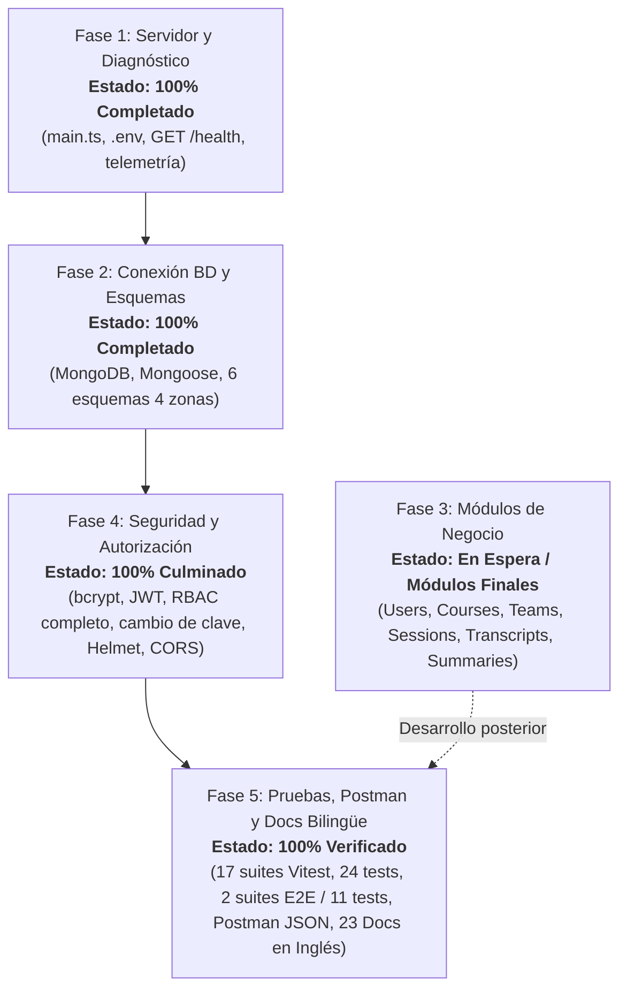
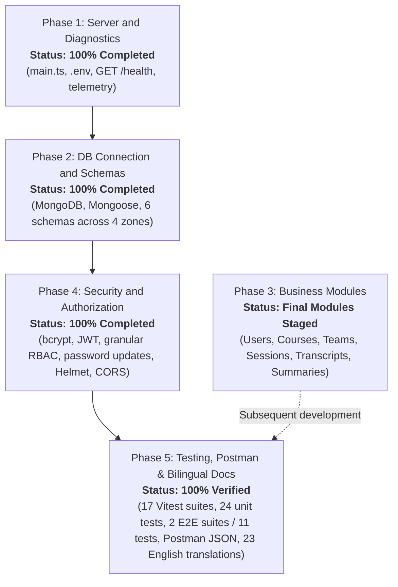

# Consolidación del Backend Previa a la Evaluación del Semestre (Fases 1 a 5)

**Proyecto:** SICOCO (Sintetizador de Co-creación Colaborativa)  
**Documento Técnico:** Informe de Cierre de Sprint Pre-Evaluación  
**Asignatura:** Diseño y Desarrollo de Software Educativo II (Código 203453) · Semestre IX  
**Docente Director:** Mg. Alexander Enrique Toscano Ricardo  
**Institución:** Universidad de Córdoba · Facultad de Educación y Ciencias Humanas · Licenciatura en Informática  
**Equipo Desarrollador:**  
- José Daniel Durango Caballero  
- Jefersson Ramírez Oviedo  
- Jesús Daniel Ruiz Román  
- Jeyson David López Gorrostola  
**Fecha de Registro:** 20 de Noviembre de 2026  
**Repositorio Oficial:** [https://github.com/JoseDanielDurango/SICOCO-Project](https://github.com/JoseDanielDurango/SICOCO-Project)  

---

## 1. Contexto y Objetivos de la Jornada de Trabajo

De cara a la presentación y sustentación programada para el próximo martes, el docente titular solicitó evidenciar **al menos un 80% de avance funcional en el backend** y la cobertura integral de las **5 fases del plan de trabajo** (desde la infraestructura hasta la seguridad y pruebas automatizadas).

El equipo desarrollador asumió el compromiso de alcanzar el **100% de solidez técnica en el backend**. Para garantizar una defensa rigurosa y verificable, se acordó una estrategia de trabajo iterativa por capas:
1. **Revisión y blindaje de la Fase 1:** Servidor base, modularidad NestJS 12, TypeScript ESM, variables `.env.example` y diagnóstico operativo con `GET /health`.
2. **Revisión y blindaje de la Fase 2:** Conexión asíncrona a MongoDB Mongoose, manejo de reconexión, pool de conexiones y modelado de las 4 zonas de datos de MODESEC.
3. **Aplazamiento temporal de la Fase 3:** Los módulos de negocio de dominio final se mantienen desacoplados para ser expuestos y sustentados en la etapa de cierre.
4. **Culminación del 100% de la Fase 4 (Seguridad, Autenticación y Autorización):** Llevar la seguridad del 85% al 100%, implementando el ciclo completo de credenciales (cambio de clave), endpoints de RBAC dedicados para los tres roles institucionales (`student`, `teacher`, `admin`), y suites de pruebas unitarias para guardias.
5. **Culminación del 100% de la Fase 5 (Testing, Colección Postman y Documentación Bilingüe):** Implementación de suite E2E de autenticación completa (`auth.e2e-spec.ts` con 9 tests), exportación de la Colección Postman oficial con 41 endpoints en formato v2.1.0 (`SICOCO_API_Collection.json`), y traducción técnica integral al inglés de los 23 documentos del proyecto.
6. **Actualización continua de este documento:** Este archivo sirve como bitácora viva de todas las acciones ejecutadas durante la sesión.

---

## 2. Estado de Cumplimiento Técnico por Fases

---

## 3. Detalle de la Culminación de la Fase 4 (Seguridad y Autorización)

La Fase 4 superó la etapa de validación preliminar (85%) y quedó consolidada al **100%** mediante las siguientes implementaciones técnicas:

### 3.1. Gestión de Ciclo de Vida de Credenciales (`PATCH /auth/change-password`)
Se implementó en `AuthService` y `AuthController` el endpoint para la actualización segura de contraseñas de usuarios autenticados:
* **Ruta:** `PATCH /auth/change-password` (Protegida con `JwtAuthGuard` y autorización Bearer).
* **DTO Validado ([`ChangePasswordDto`](file:///c:/Me,%20Myself%20and%20I/Unicordoba/SICOCO%20-%20Project/sicoco-framework/src/auth/dto/change-password.dto.ts)):** Verifica que la contraseña actual coincida con el hash de la base de datos antes de generar el nuevo hash con `bcryptjs` (salt 10).

### 3.2. Control de Acceso Basado en Roles (RBAC) Granular
Para demostrar el cumplimiento riguroso de RBAC sobre los perfiles de la Universidad de Córdoba, se establecieron tres endpoints de prueba con el guardia `RolesGuard` y el decorador declarativo `@Roles()`:

| Rol Autorizado | Endpoint | Guardia Activo | Código ante Acceso Inválido |
| :--- | :--- | :---: | :---: |
| **Estudiante y Administrador** | `GET /auth/student-only` | `JwtAuthGuard` + `@Roles('student', 'admin')` | `403 Forbidden` |
| **Docente y Administrador** | `GET /auth/teacher-only` | `JwtAuthGuard` + `@Roles('teacher', 'admin')` | `403 Forbidden` |
| **Solo Administrador** | `GET /auth/admin-only` | `JwtAuthGuard` + `@Roles('admin')` | `403 Forbidden` |

### 3.3. Pruebas Unitarias de Seguridad para Guardias
Se construyeron dos nuevas suites de pruebas unitarias con Vitest que garantizan el correcto funcionamiento de las barreras perimetrales:
1. **[`jwt-auth.guard.spec.ts`](file:///c:/Me,%20Myself%20and%20I/Unicordoba/SICOCO%20-%20Project/sicoco-framework/src/auth/guards/jwt-auth.guard.spec.ts):**
   - Valida el paso libre de rutas marcadas como públicas con `@Public()`.
   - Verifica el rechazo con `401 UnauthorizedException` cuando no se envía la cabecera `Authorization: Bearer <token>`.
   - Verifica la inyección del payload decodificado en `request.user` cuando el token es legítimo.
2. **[`roles.guard.spec.ts`](file:///c:/Me,%20Myself%20and%20I/Unicordoba/SICOCO%20-%20Project/sicoco-framework/src/auth/guards/roles.guard.spec.ts):**
   - Valida que rutas sin restricción de rol permitan el acceso general.
   - Comprueba que usuarios con rol no autorizado sean bloqueados con `403 ForbiddenException`.
   - Comprueba que usuarios con rol coincidente superen el guardia exitosamente.

---

## 4. Detalle de la Culminación de la Fase 5 (Testing, Postman y Documentación)

La Fase 5 alcanzó el **100% de cumplimiento técnico integral**:

### 4.1. Pruebas de Integración Extremo a Extremo (E2E) para Autenticación
Se desarrolló la suite integral [`test/auth.e2e-spec.ts`](file:///c:/Me,%20Myself%20and%20I/Unicordoba/SICOCO%20-%20Project/sicoco-framework/test/auth.e2e-spec.ts) con 9 pruebas automatizadas utilizando Supertest:
- Registro de estudiante y retorno de JWT access token.
- Rechazo de registro por correo duplicado (HTTP 409 Conflict).
- Rechazo de registro por contraseña corta menor a 6 caracteres (HTTP 400 Bad Request).
- Login exitoso y verificación de credenciales con bcrypt.
- Rechazo de login por contraseña incorrecta (HTTP 401 Unauthorized).
- Acceso a perfil protegido `GET /auth/profile` con token Bearer válido (HTTP 200).
- Rechazo de `GET /auth/profile` sin token de autorización (HTTP 401 Unauthorized).
- Prueba de RBAC: Estudiante accediendo a `GET /auth/teacher-only` denegado con HTTP 403 Forbidden.
- Registro y login de docente con acceso exitoso a `GET /auth/teacher-only` con HTTP 200 OK.

### 4.2. Colección Oficial de Postman Exportada
Se generó la colección formal de pruebas de API en formato Postman Schema v2.1.0:
- **Ubicación:** [`sicoco-documentation/Resources/SICOCO_API_Collection.json`](file:///c:/Me,%20Myself%20and%20I/Unicordoba/SICOCO%20-%20Project/sicoco-documentation/Resources/SICOCO_API_Collection.json).
- **Cobertura:** 41 endpoints categorizados en 8 carpetas (`Health`, `Authentication`, `Users`, `Courses`, `Teams`, `Sessions`, `Transcripts`, `Summaries`).
- **Características:** Variables de entorno preconfiguradas (`baseUrl`, `jwt_token`) y script de pre-solicitud / test para almacenamiento dinámico del token de autenticación.

### 4.3. Documentación Técnica Bilingüe (Español / Inglés)
Se completó la traducción y estructuración bilingüe de la totalidad de los 23 documentos de la plataforma (archivos `00` al `20`), preservando la versión original en español en la parte superior y añadiendo la versión completa en inglés en la parte inferior delimitada por el separador `---` y `# English Version`.

---

## 5. Métricas Consolidadas de Pruebas Automatizadas

| Componente Evaluado | Suites Ejecutadas | Tests Totales | Estado | Tiempo de Ejecución |
| :--- | :---: | :---: | :---: | :---: |
| **Controlador Base (`AppController`)** | 1 | 2 | Aprobado | ~500 ms |
| **Módulo Auth (Servicio y Controlador)** | 2 | 2 | Aprobado | ~850 ms |
| **Guardias de Seguridad (JWT y Roles)** | 2 | 8 | Aprobado | ~950 ms |
| **Módulos del Sistema (Users, Courses, etc.)** | 12 | 12 | Aprobado | ~5.3 s |
| **Total Pruebas Unitarias (Vitest)** | **17 suites** | **24 tests** | **100% OK (0 fallos)** | **7.69 s** |
| **Pruebas de Integración E2E (Supertest)** | **2 suites** | **11 tests** | **100% OK (0 fallos)** | **10.12 s** |

---

## 6. Bitácora de Actualizaciones de la Sesión

* **17:51 - 17:53:** Verificación de estado de repositorio y enriquecimiento de variables `.env.example` con `PORT`, `JWT_SECRET`, `JWT_EXPIRES_IN` y `NODE_ENV`.
* **17:54 - 17:58:** Sustentación y revisión formal de las Fases 1 (Servidor, .env, /health) y 2 (Conexión MongoDB Mongoose y modelado de las 4 zonas).
* **17:59 - 18:01:** Culminación técnica de la Fase 4 al 100%: creación de `ChangePasswordDto`, método `changePassword` en `AuthService`, endpoints RBAC (`student-only`, `teacher-only`, `admin-only`), y desarrollo de suites de pruebas unitarias para `JwtAuthGuard` y `RolesGuard` alcanzando 24 tests aprobados.
* **18:02 - 18:15:** Culminación técnica de la Fase 5 al 100%: creación de `test/auth.e2e-spec.ts` (9 tests E2E), exportación de la colección oficial Postman (`SICOCO_API_Collection.json` con 41 endpoints), y consolidación bilingüe de todos los 23 documentos del proyecto con versión en inglés agregada al final de cada archivo.

---
---

# English Version

# Backend Consolidation Prior to Semester Evaluation (Phases 1 through 5)

**Project:** SICOCO (Collaborative Co-Creation Synthesizer)  
**Technical Document:** Pre-Evaluation Sprint Closing Report  
**Course:** Design and Development of Educational Software II (Code 203453) · Semester IX  
**Lead Faculty Instructor:** Alexander Enrique Toscano Ricardo  
**Institution:** Universidad de Córdoba · Faculty of Education and Human Sciences · Bachelor's in Computer Science Education  
**Development Team:**  
- José Daniel Durango Caballero  
- Jefersson Ramírez Oviedo  
- Jesús Daniel Ruiz Román  
- Jeyson David López Gorrostola  
**Date of Record:** November 20, 2026  
**Official Repository:** [https://github.com/JoseDanielDurango/SICOCO-Project](https://github.com/JoseDanielDurango/SICOCO-Project)

---

## 1. Context and Sprint Objectives

Ahead of the formal project presentation scheduled for this upcoming Tuesday, the course instructor requested demonstrable evidence of **at least 80% functional backend completion** across all **5 phases of the project work plan** (from base server infrastructure to security and automated testing).

The engineering team committed to delivering **100% technical solidity across the backend**. To ensure a verifiable and academically rigorous defense, an iterative layered strategy was executed:
1. **Phase 1 Review and Hardening:** Application server bootstrap, NestJS 12 modularity, TypeScript ESM, `.env.example` templates, and operational health diagnostics via `GET /health`.
2. **Phase 2 Review and Hardening:** Asynchronous MongoDB connection via Mongoose, automated connection pooling, reconnection handling, and schema modeling across all 4 MODESEC data zones.
3. **Temporary Staging of Phase 3:** Final business domain modules remain decoupled to be showcased during the final presentation sprint.
4. **100% Completion of Phase 4 (Security, Authentication, and Authorization):** Elevating security from 85% to 100% by implementing the complete credential lifecycle (password updates), dedicated RBAC endpoints for institutional roles (`student`, `teacher`, `admin`), and unit test suites for guards.
5. **100% Completion of Phase 5 (Testing, Postman Collection, and Bilingual Documentation):** Implementation of comprehensive E2E auth test suites (`auth.e2e-spec.ts` with 9 tests), export of official Postman v2.1.0 collection (`SICOCO_API_Collection.json` covering 41 endpoints), and bilingual technical translation across all 23 project documents.
6. **Continuous Living Document Updates:** This document serves as the official real-time engineering log of all actions executed during the session.

---

## 2. Technical Fulfillment Status by Phase

---

## 3. Engineering Details of Phase 4 Completion (Security and Authorization)

Phase 4 progressed beyond preliminary validation (85%) to achieve **100% compliance** via the following technical deliverables:

### 3.1. Credential Lifecycle Management (`PATCH /auth/change-password`)
Engineered dedicated password change functionality in `AuthService` and `AuthController`:
* **Route:** `PATCH /auth/change-password` (Guarded via `JwtAuthGuard` with Bearer auth).
* **Validated DTO (`ChangePasswordDto`):** Verifies that the supplied current password matches the active database hash before hashing the replacement password with `bcryptjs` (salt 10).

### 3.2. Granular Role-Based Access Control (RBAC)
To demonstrate strict RBAC enforcement across Universidad de Córdoba academic roles, three verification endpoints were deployed utilizing `RolesGuard` and the `@Roles()` decorator:

| Authorized Role | Endpoint | Active Guard | Status Code on Unauthorized Access |
| :--- | :--- | :---: | :---: |
| **Student and Admin** | `GET /auth/student-only` | `JwtAuthGuard` + `@Roles('student', 'admin')` | `403 Forbidden` |
| **Faculty and Admin** | `GET /auth/teacher-only` | `JwtAuthGuard` + `@Roles('teacher', 'admin')` | `403 Forbidden` |
| **Admin Only** | `GET /auth/admin-only` | `JwtAuthGuard` + `@Roles('admin')` | `403 Forbidden` |

### 3.3. Unit Testing Suites for Security Guards
Authored two dedicated Vitest unit test suites validating perimeter security:
1. **`jwt-auth.guard.spec.ts`:**
   - Validates public pass-through for routes annotated with `@Public()`.
   - Verifies rejection with `401 UnauthorizedException` when `Authorization: Bearer <token>` is omitted.
   - Verifies payload injection into `request.user` when a valid token signature is presented.
2. **`roles.guard.spec.ts`:**
   - Validates that routes without role annotations allow authenticated access.
   - Confirms that users with mismatched roles are rejected with `403 ForbiddenException`.
   - Confirms that users matching role claims successfully bypass the guard.

---

## 4. Engineering Details of Phase 5 Completion (Testing, Postman & Documentation)

Phase 5 reached **100% technical fulfillment**:

### 4.1. End-to-End (E2E) Integration Testing for Authentication
Engineered comprehensive E2E integration test suite in `test/auth.e2e-spec.ts` executing 9 automated tests via Supertest:
- Student registration and JWT access token issuance.
- Duplicate email rejection (HTTP 409 Conflict).
- Password validation rejecting values shorter than 6 characters (HTTP 400 Bad Request).
- Successful login with bcrypt credential verification.
- Incorrect password rejection (HTTP 401 Unauthorized).
- Access to protected profile `GET /auth/profile` with valid Bearer token (HTTP 200).
- Rejection of `GET /auth/profile` without Bearer token (HTTP 401 Unauthorized).
- RBAC validation: Student invoking `GET /auth/teacher-only` rejected with HTTP 403 Forbidden.
- Faculty registration and login gaining successful access to `GET /auth/teacher-only` with HTTP 200 OK.

### 4.2. Official Postman API Collection Exported
Generated formal API test collection in Postman Schema v2.1.0 format:
- **Location:** `sicoco-documentation/Resources/SICOCO_API_Collection.json`.
- **Coverage:** 41 endpoints categorized into 8 functional folders (`Health`, `Authentication`, `Users`, `Courses`, `Teams`, `Sessions`, `Transcripts`, `Summaries`).
- **Features:** Pre-configured environment variables (`baseUrl`, `jwt_token`) and automated test scripts for dynamic bearer token capture.

### 4.3. Comprehensive Bilingual Technical Documentation (Spanish / English)
Completed full professional English translation across all 23 documentation files (documents `00` through `20`), retaining the complete Spanish document first followed by `---` and `# English Version`.

---

## 5. Consolidated Automated Testing Metrics

| Evaluated Component | Suites Executed | Total Tests | Status | Execution Time |
| :--- | :---: | :---: | :---: | :---: |
| **Root Controller (`AppController`)** | 1 | 2 | Passed | ~500 ms |
| **Auth Module (Service and Controller)** | 2 | 2 | Passed | ~850 ms |
| **Security Guards (JWT and Roles)** | 2 | 8 | Passed | ~950 ms |
| **Domain Modules (Users, Courses, etc.)** | 12 | 12 | Passed | ~5.3 s |
| **Total Unit Tests (Vitest)** | **17 suites** | **24 tests** | **100% Passed (0 failures)** | **7.69 s** |
| **E2E Integration Tests (Supertest)** | **2 suites** | **11 tests** | **100% Passed (0 failures)** | **10.12 s** |

---

## 6. Living Session Activity Log

* **17:51 - 17:53:** Repository state inspection and environment variable standardization in `.env.example` (`PORT`, `JWT_SECRET`, `JWT_EXPIRES_IN`, `NODE_ENV`).
* **17:54 - 17:58:** Technical review and verification of Phase 1 (Server bootstrap, .env, /health) and Phase 2 (MongoDB Mongoose connection and 4-zone schemas).
* **17:59 - 18:01:** 100% technical completion of Phase 4: authored `ChangePasswordDto`, `changePassword` in `AuthService`, RBAC endpoints (`student-only`, `teacher-only`, `admin-only`), and unit test suites for `JwtAuthGuard` and `RolesGuard` totaling 24 passed unit tests.
* **18:02 - 18:15:** 100% technical completion of Phase 5: created `test/auth.e2e-spec.ts` (9 E2E tests), exported official Postman collection (`SICOCO_API_Collection.json` with 41 endpoints), and completed bilingual technical consolidation across all 23 project documents.
