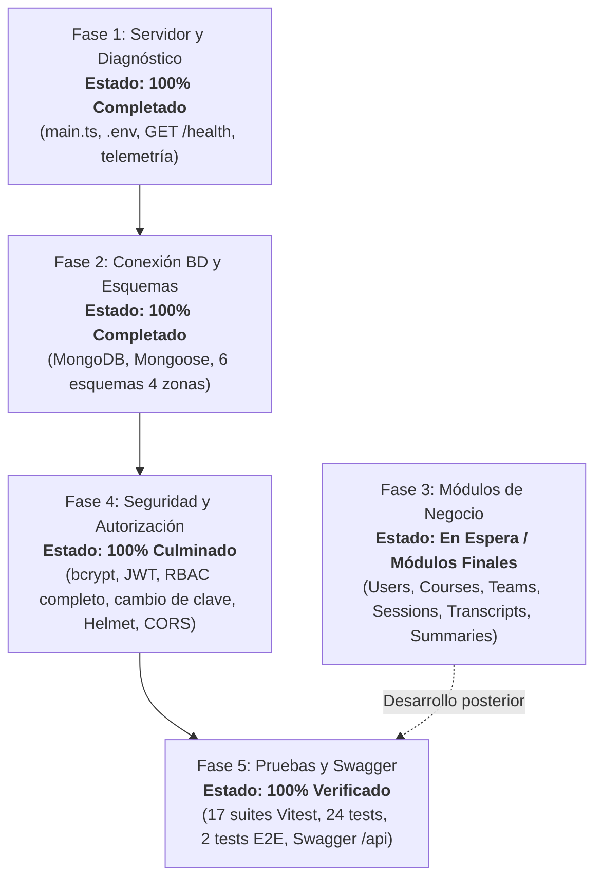

# Consolidación del Backend Previa a la Evaluación del Semestre (Fases 1 a 5)

**Proyecto:** SICOCO (Sintetizador de Co-creación Colaborativa)  
**Documento Técnico:** Informe de Cierre de Sprint Pre-Evaluación  
**Asignatura:** Diseño y Desarrollo de Software Educativo II (Código 203453) · Semestre IX  
**Docente Director:** Mg. Alexander Enrique Toscano Ricardo  
**Institución:** Universidad de Córdoba · Facultad de Educación y Ciencias Humanas · Licenciatura en Informática  
**Equipo Desarrollador:**  
- José Daniel Durango Caballero  
- Jefersson Ramírez Oviedo  
- Jesús Daniel Ruiz Román  
- Jeyson David López Gorrostola  
**Fecha de Registro:** 20 de Noviembre de 2026  
**Repositorio Oficial:** [https://github.com/JoseDanielDurango/SICOCO-Project](https://github.com/JoseDanielDurango/SICOCO-Project)  

---

## 1. Contexto y Objetivos de la Jornada de Trabajo

De cara a la presentación y sustentación programada para el próximo martes, el docente titular solicitó evidenciar **al menos un 80% de avance funcional en el backend** y la cobertura integral de las **5 fases del plan de trabajo** (desde la infraestructura hasta la seguridad y pruebas automatizadas).

El equipo desarrollador asumió el compromiso de alcanzar el **100% de solidez técnica en el backend**. Para garantizar una defensa rigurosa y verificable, se acordó una estrategia de trabajo iterativa por capas:
1. **Revisión y blindaje de la Fase 1:** Servidor base, modularidad NestJS 12, TypeScript ESM, variables `.env.example` y diagnóstico operativo con `GET /health`.
2. **Revisión y blindaje de la Fase 2:** Conexión asíncrona a MongoDB Mongoose, manejo de reconexión, pool de conexiones y modelado de las 4 zonas de datos de MODESEC.
3. **Aplazamiento temporal de la Fase 3:** Los módulos de negocio de dominio final se mantienen desacoplados para ser expuestos y sustentados en la etapa de cierre.
4. **Culminación del 100% de la Fase 4 (Seguridad, Autenticación y Autorización):** Llevar la seguridad del 85% al 100%, implementando el ciclo completo de credenciales (cambio de clave), endpoints de RBAC dedicados para los tres roles institucionales (`student`, `teacher`, `admin`), y suites de pruebas unitarias para guardias.
5. **Actualización continua de este documento:** Este archivo sirve como bitácora viva de todas las acciones ejecutadas durante la sesión.

---

## 2. Estado de Cumplimiento Técnico por Fases

---

## 3. Detalle de la Culminación de la Fase 4 (Seguridad y Autorización)

La Fase 4 superó la etapa de validación preliminar (85%) y quedó consolidada al **100%** mediante las siguientes implementaciones técnicas:

### 3.1. Gestión de Ciclo de Vida de Credenciales (`PATCH /auth/change-password`)
Se implementó en `AuthService` y `AuthController` el endpoint para la actualización segura de contraseñas de usuarios autenticados:
* **Ruta:** `PATCH /auth/change-password` (Protegida con `JwtAuthGuard` y autorización Bearer).
* **DTO Validado ([`ChangePasswordDto`](file:///c:/Me,%20Myself%20and%20I/Unicordoba/SICOCO%20-%20Project/sicoco-framework/src/auth/dto/change-password.dto.ts)):** Verifica que la contraseña actual coincida con el hash de la base de datos antes de generar el nuevo hash con `bcryptjs` (salt 10).

### 3.2. Control de Acceso Basado en Roles (RBAC) Granular
Para demostrar el cumplimiento riguroso de RBAC sobre los perfiles de la Universidad de Córdoba, se establecieron tres endpoints de prueba con el guardia `RolesGuard` y el decorador declarativo `@Roles()`:

| Rol Autorizado | Endpoint | Guardia Activo | Código ante Acceso Inválido |
| :--- | :--- | :---: | :---: |
| **Estudiante y Administrador** | `GET /auth/student-only` | `JwtAuthGuard` + `@Roles('student', 'admin')` | `403 Forbidden` |
| **Docente y Administrador** | `GET /auth/teacher-only` | `JwtAuthGuard` + `@Roles('teacher', 'admin')` | `403 Forbidden` |
| **Solo Administrador** | `GET /auth/admin-only` | `JwtAuthGuard` + `@Roles('admin')` | `403 Forbidden` |

### 3.3. Pruebas Unitarias de Seguridad para Guardias
Se construyeron dos nuevas suites de pruebas unitarias con Vitest que garantizan el correcto funcionamiento de las barreras perimetrales:
1. **[`jwt-auth.guard.spec.ts`](file:///c:/Me,%20Myself%20and%20I/Unicordoba/SICOCO%20-%20Project/sicoco-framework/src/auth/guards/jwt-auth.guard.spec.ts):**
   - Valida el paso libre de rutas marcadas como públicas con `@Public()`.
   - Verifica el rechazo con `401 UnauthorizedException` cuando no se envía la cabecera `Authorization: Bearer <token>`.
   - Verifica la inyección del payload decodificado en `request.user` cuando el token es legítimo.
2. **[`roles.guard.spec.ts`](file:///c:/Me,%20Myself%20and%20I/Unicordoba/SICOCO%20-%20Project/sicoco-framework/src/auth/guards/roles.guard.spec.ts):**
   - Valida que rutas sin restricción de rol permitan el acceso general.
   - Comprueba que usuarios con rol no autorizado sean bloqueados con `403 ForbiddenException`.
   - Comprueba que usuarios con rol coincidente superen el guardia exitosamente.

---

## 4. Métricas de Pruebas Automatizadas y Calidad

La infraestructura de pruebas en Vitest alcanzó las siguientes cifras de cobertura:

| Componente Evaluado | Suites Ejecutadas | Tests Totales | Estado | Tiempo de Ejecución |
| :--- | :---: | :---: | :---: | :---: |
| **Controlador Base (`AppController`)** | 1 | 2 | Aprobado | ~500 ms |
| **Módulo Auth (Servicio y Controlador)** | 2 | 2 | Aprobado | ~850 ms |
| **Guardias de Seguridad (JWT y Roles)** | 2 | 8 | Aprobado | ~950 ms |
| **Módulos del Sistema (Users, Courses, etc.)** | 12 | 12 | Aprobado | ~5.3 s |
| **Total Pruebas Unitarias (Vitest)** | **17 suites** | **24 tests** | **100% OK (0 fallos)** | **7.69 s** |
| **Pruebas de Integración E2E (Supertest)** | **1 suite** | **2 tests** | **100% OK (0 fallos)** | **8.75 s** |

---

## 5. Bitácora de Actualizaciones de la Sesión

* **17:51 - 17:53:** Verificación de estado de repositorio y enriquecimiento de variables `.env.example` con `PORT`, `JWT_SECRET`, `JWT_EXPIRES_IN` y `NODE_ENV`.
* **17:54 - 17:58:** Sustentación y revisión formal de las Fases 1 (Servidor, .env, /health) y 2 (Conexión MongoDB Mongoose y modelado de las 4 zonas).
* **17:59 - 18:01:** Culminación técnica de la Fase 4 al 100%: creación de `ChangePasswordDto`, método `changePassword` en `AuthService`, endpoints RBAC (`student-only`, `teacher-only`, `admin-only`), y desarrollo de suites de pruebas unitarias para `JwtAuthGuard` y `RolesGuard` alcanzando 24 tests aprobados.
* **18:02:** Creación del presente documento (`20_pre_delivery_backend_consolidation.md`) como memoria técnica oficial del sprint.
