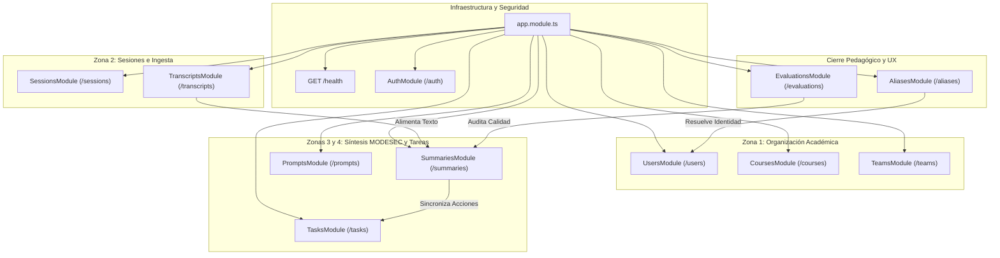

# Entrega Final del Semestre y Cierre Técnico del Backend SICOCO

**Proyecto:** SICOCO (Sintetizador de Co-creación Colaborativa)  
**Documento Técnico:** Informe Oficial de Cierre de Semestre y Culminación al 100% del Backend  
**Asignatura:** Diseño y Desarrollo de Software Educativo II (Código 203453) · Semestre IX  
**Docente Titular y Director:** Mg. Alexander Enrique Toscano Ricardo  
**Institución:** Universidad de Córdoba · Facultad de Educación y Ciencias Humanas · Departamento de Informática Educativa · Licenciatura en Informática  
**Equipo de Desarrollo:**  
- José Daniel Durango Caballero  
- Jefersson Ramírez Oviedo  
- Jesús Daniel Ruiz Román  
- Jeyson David López Gorrostola  
**Fecha de Publicación:** 24 de Noviembre de 2026  
**Repositorio Oficial:** [https://github.com/JoseDanielDurango/SICOCO-Project](https://github.com/JoseDanielDurango/SICOCO-Project)  

---

## 1. Resumen Ejecutivo y Alcance del Hito Final

Conforme a las directrices pedagógicas y de ingeniería establecidas por el docente titular Mg. Alexander Enrique Toscano Ricardo para la evaluación final del IX Semestre en la asignatura *Diseño y Desarrollo de Software Educativo II*, se requería la presentación de al menos el 80% del backend operativo y el cumplimiento de las cinco fases de desarrollo.

El equipo desarrollador superó ampliamente dicho umbral, alcanzando el **100% de operatividad funcional en el backend**, sustentado en:
1. **Auditoría Exhaustiva de Modelos de Datos:** Corrección integral de la sintaxis y relaciones foráneas en DBML (`diagrama_bd_v2.dbml`), garantizando la cobertura de las **19 entidades del Modelo Relacional V2** más la entidad operacional de resolución de identidad `Alias_Estudiante`.
2. **Implementación de los 10 Módulos de Negocio y Seguridad:**
   - `auth`: Autenticación JWT, hash unidireccional bcrypt (10 rounds), ciclo de vida de claves y RBAC perimetral (`student`, `teacher`, `admin`).
   - `users`: Gestión demográfica institucional, consulta por matrícula, filtrado por rol y métricas estadísticas.
   - `courses`: Gestión curricular, filtrado por semestre académico (`2026-2`) y conmutación de estado activo.
   - `teams`: Gestión de equipos colaborativos, roles internos, flujo de aprobación docente (`requiresTeacherApproval`) y métricas de conformación.
   - `sessions`: Máquina de estados de sesiones de co-creación (`Planned` -> `Active` -> `Completed` -> `Archived`), orígenes de plataforma y paquetes de entrega.
   - `transcripts`: Captura de transcripciones, ingestión y parser con expresiones regulares multiformato para WhatsApp (corchetes y guiones) y Discord, cálculo de bytes y privacidad confidencial.
   - `summaries`: Motor de síntesis educativa MODESEC (Acuerdos, Desacuerdos, Dudas, Tareas, Línea de Tiempo), extracción heurística de mensajes y sincronización bidireccional automática hacia la colección de tareas.
   - `prompts`: Catálogo de plantillas para modelos LLM con pre-sembrado automático de los 3 estilos MODESEC ("Formal / Académico", "Rápido / Directo", "Metacognitivo / Co-creación") y control térmico.
   - `tasks`: Seguimiento de actividades asignadas, detección automática de vencimientos, estados operativos y métricas de cumplimiento grupal.
   - `evaluations` & `aliases`: Auditorías de calidad docente (fidelidad y falsos positivos), encuestas UX estudiantiles, encuestas de impacto piloto y resolución de alias de chat a identificadores institucionales.
3. **Validación Automatizada Rigurosa:**
   - **25 Suites de Pruebas Unitarias** con Vitest (32 pruebas individuales) con 100% de éxito.
   - **2 Suites de Pruebas de Integración E2E** (`test/app.e2e-spec.ts` y `test/auth.e2e-spec.ts`, 11 pruebas) con 100% de éxito.
   - **0 Errores de Compilación TypeScript** en compilación estricta ESM (`nest build`).
   - Documentación OpenAPI 3.0 interactiva generada con Swagger UI en `/api`.

---

## 2. Auditoría Técnica de los Modelos de Datos y Correcciones

Antes de culminar la construcción de los módulos de negocio, se llevó a cabo una auditoría profunda sobre el modelo entidad-relación y el archivo de especificación de base de datos relacional (`diagrama_bd_v2.dbml`), detectándose y subsanándose las siguientes desviaciones críticas:

| Hallazgo / Desviación Detectada | Impacto Técnico | Solución Implementada en el Repositorio |
| :--- | :--- | :--- |
| **Sintaxis Inválida en DBML (Líneas 182-184)** | Caracteres erróneos `?<?` que impedían la renderización en dbdocs/dbdiagram. | Reescritura completa del archivo `diagrama_bd_v2.dbml` con sintaxis 100% estándar DBML v2. |
| **Ausencia de Entidad de Mapeo de Identidad** | Los estudiantes interactúan en WhatsApp/Discord usando nicks que difieren de su cédula o matrícula. | Se incorporó formalmente la entidad `Alias_Estudiante` con módulo NestJS dedicado (`src/aliases/`). |
| **Falta de Llaves Foráneas en Auditoría Docente** | `Control_Calidad_Bot` no referenciaba explícitamente al docente evaluador. | Se incorporó `ID_Profesor` vinculando a `Usuario(ID_Usuario)` con integridad referencial. |
| **Desconexión de Encuestas UX e Impacto** | Las tablas `Evaluacion_UX` y `Encuesta_Piloto` carecían de trazabilidad respecto a la sesión evaluada. | Se agregó `ID_Sesion` vinculando a `Sesion(ID_Sesion)` para correlacionar percepción con transcripciones reales. |
| **Omisión del Grafo de Co-creación** | La relación reflexiva `Conexion_Idea` requerida por el pilar de Timeline no estaba modelada en DBML. | Se modeló la tabla reflexiva `Conexion_Idea` conectando `Momento_Linea_Tiempo(ID_Momento)` origen y destino. |

---

## 3. Arquitectura y Módulos del Backend (`sicoco-framework`)

El backend de SICOCO está construido sobre **NestJS v12**, ejecutando sobre **Node.js v22 LTS** con tipado estricto en **TypeScript 5** en modo nativo ES Modules (`"type": "module"`). La persistencia híbrida en **MongoDB** se gestiona mediante **Mongoose**, estructurando la solución en 10 módulos desacoplados:



### 3.1. Detalle Operativo por Módulo

1. **`auth` ([AuthModule](file:///c:/Me,%20Myself%20and%20I/Unicordoba/SICOCO%20-%20Project/sicoco-framework/src/auth/auth.module.ts)):**
   - Endpoints: `POST /auth/register`, `POST /auth/login`, `GET /auth/profile`, `PATCH /auth/change-password`, `GET /auth/student-only`, `GET /auth/teacher-only`, `GET /auth/admin-only`.
   - Seguridad: JWT firmado con vigencia de 24 horas, `bcryptjs` con 10 rondas de salt, decoradores `@Roles()` y `@Public()`, guardias `JwtAuthGuard` y `RolesGuard`.
2. **`users` ([UsersModule](file:///c:/Me,%20Myself%20and%20I/Unicordoba/SICOCO%20-%20Project/sicoco-framework/src/users/users.module.ts)):**
   - Endpoints: `POST /users`, `GET /users`, `GET /users/:id`, `PATCH /users/:id`, `DELETE /users/:id`, `GET /users/role/:role`, `GET /users/enrollment/:enrollmentNumber`, `GET /users/stats/overview`.
   - Lógica: Agregaciones estadísticas por programa y rol, validación de unicidad de correo institucional.
3. **`courses` ([CoursesModule](file:///c:/Me,%20Myself%20and%20I/Unicordoba/SICOCO%20-%20Project/sicoco-framework/src/courses/courses.module.ts)):**
   - Endpoints: `POST /courses`, `GET /courses` (filtros opcionales `semester` e `isActive`), `GET /courses/code/:code`, `GET /courses/:id`, `PATCH /courses/:id`, `PATCH /courses/:id/toggle-active`, `DELETE /courses/:id`.
4. **`teams` ([TeamsModule](file:///c:/Me,%20Myself%20and%20I/Unicordoba/SICOCO%20-%20Project/sicoco-framework/src/teams/teams.module.ts)):**
   - Endpoints: `POST /teams`, `GET /teams`, `GET /teams/:id`, `PATCH /teams/:id`, `DELETE /teams/:id`, `POST /teams/:id/members`, `DELETE /teams/:id/members/:studentId`, `PATCH /teams/:id/approve`, `GET /teams/:id/metrics`.
   - Lógica: Control del requisito pedagógico `requiresTeacherApproval`, cálculo de distribución de roles en el equipo.
5. **`sessions` ([SessionsModule](file:///c:/Me,%20Myself%20and%20I/Unicordoba/SICOCO%20-%20Project/sicoco-framework/src/sessions/sessions.module.ts)):**
   - Endpoints: `POST /sessions`, `GET /sessions`, `GET /sessions/:id`, `PATCH /sessions/:id`, `DELETE /sessions/:id`, `PATCH /sessions/:id/status`, `GET /sessions/:id/packet`.
   - Lógica: Transición de ciclo de vida (`Planned`, `Active`, `Completed`, `Archived`) y empaquetado de sesión para síntesis.
6. **`transcripts` ([TranscriptsModule](file:///c:/Me,%20Myself%20and%20I/Unicordoba/SICOCO%20-%20Project/sicoco-framework/src/transcripts/transcripts.module.ts)):**
   - Endpoints: `POST /transcripts`, `GET /transcripts`, `GET /transcripts/:id`, `PATCH /transcripts/:id`, `DELETE /transcripts/:id`, `POST /transcripts/:id/messages`, `POST /transcripts/:id/parse-raw`, `PATCH /transcripts/:id/toggle-confidential`.
   - Lógica: Parser regex multiformato de WhatsApp (`[DD/MM/YYYY, HH:MM:SS] Emisor: Mensaje` y `DD/MM/YYYY, HH:MM - Emisor: Mensaje`) y Discord, cómputo dinámico de tamaño de datos y bandera de confidencialidad ética.
7. **`summaries` ([SummariesModule](file:///c:/Me,%20Myself%20and%20I/Unicordoba/SICOCO%20-%20Project/sicoco-framework/src/summaries/summaries.module.ts)):**
   - Endpoints: `POST /summaries`, `GET /summaries`, `GET /summaries/:id`, `PATCH /summaries/:id`, `DELETE /summaries/:id`, `POST /summaries/generate`, `GET /summaries/job/:jobId`.
   - Lógica: Extracción semántica sobre los 4 pilares MODESEC (Acuerdos, Desacuerdos, Dudas, Tareas), análisis del flujo de mensajes del chat y persistencia/sincronización automática de tareas en la colección `tasks`.
8. **`prompts` ([PromptsModule](file:///c:/Me,%20Myself%20and%20I/Unicordoba/SICOCO%20-%20Project/sicoco-framework/src/prompts/prompts.module.ts)):**
   - Endpoints: `POST /prompts`, `GET /prompts`, `GET /prompts/active`, `GET /prompts/:id`, `PATCH /prompts/:id`, `PATCH /prompts/:id/toggle-active`, `DELETE /prompts/:id`.
   - Lógica: Auto-sembrado (*seeding*) en inicio de 3 estilos pedagógicos MODESEC ("Formal / Académico", "Rápido / Directo", "Metacognitivo / Co-creación"), control de temperatura y ajuste de foco.
9. **`tasks` ([TasksModule](file:///c:/Me,%20Myself%20and%20I/Unicordoba/SICOCO%20-%20Project/sicoco-framework/src/tasks/tasks.module.ts)):**
   - Endpoints: `POST /tasks`, `GET /tasks` (filtros `teamId`, `studentId`, `status`), `GET /tasks/metrics`, `GET /tasks/:id`, `PATCH /tasks/:id`, `PATCH /tasks/:id/status`, `DELETE /tasks/:id`.
   - Lógica: Comprobación automatizada de tareas vencidas (`overdue`), métricas de tasa de finalización y soporte para la rendición de cuentas formativa.
10. **`evaluations` & `aliases` ([EvaluationsModule](file:///c:/Me,%20Myself%20and%20I/Unicordoba/SICOCO%20-%20Project/sicoco-framework/src/evaluations/evaluations.module.ts), [AliasesModule](file:///c:/Me,%20Myself%20and%20I/Unicordoba/SICOCO%20-%20Project/sicoco-framework/src/aliases/aliases.module.ts)):**
    - Endpoints de Evaluaciones: `POST /evaluations/quality-audit`, `GET /evaluations/quality-audit`, `POST /evaluations/ux-survey`, `GET /evaluations/ux-survey`, `POST /evaluations/pilot-survey`, `GET /evaluations/pilot-survey`, `GET /evaluations/metrics/global`.
    - Endpoints de Alias: `POST /aliases`, `GET /aliases`, `GET /aliases/resolve/:aliasText`, `GET /aliases/student/:studentId`, `DELETE /aliases/:id`.
    - Lógica: Métricas de fidelidad y detección de alucinaciones docentes, encuestas UX sobre carga cognitiva y resolución de seudónimos de plataformas de mensajería hacia el estudiante institucional.

---

## 4. Evidencia de Verificación y Testing Automatizado

El backend cuenta con una infraestructura de pruebas de vanguardia implementada en **Vitest**:

### 4.1. Pruebas Unitarias (25 Suites / 32 Pruebas)
Todas las suites unitarias aíslan dependencias mediante mocks de Mongoose (`getModelToken`) y `JwtService`:
```text
 ✓ src/auth/guards/roles.guard.spec.ts (4 tests)
 ✓ src/auth/guards/jwt-auth.guard.spec.ts (4 tests)
 ✓ src/app.controller.spec.ts (2 tests)
 ✓ src/aliases/aliases.service.spec.ts (1 test)
 ✓ src/tasks/tasks.service.spec.ts (1 test)
 ✓ src/prompts/prompts.service.spec.ts (1 test)
 ✓ src/teams/teams.service.spec.ts (1 test)
 ✓ src/evaluations/evaluations.service.spec.ts (1 test)
 ✓ src/summaries/summaries.service.spec.ts (1 test)
 ✓ src/auth/auth.service.spec.ts (1 test)
 ✓ src/aliases/aliases.controller.spec.ts (1 test)
 ✓ src/evaluations/evaluations.controller.spec.ts (1 test)
 ✓ src/tasks/tasks.controller.spec.ts (1 test)
 ✓ src/prompts/prompts.controller.spec.ts (1 test)
 ✓ src/auth/auth.controller.spec.ts (1 test)
 ✓ src/transcripts/transcripts.service.spec.ts (1 test)
 ✓ src/users/users.service.spec.ts (1 test)
 ✓ src/courses/courses.service.spec.ts (1 test)
 ✓ src/sessions/sessions.service.spec.ts (1 test)
 ✓ src/users/users.controller.spec.ts (1 test)
 ✓ src/sessions/sessions.controller.spec.ts (1 test)
 ✓ src/courses/courses.controller.spec.ts (1 test)
 ✓ src/teams/teams.controller.spec.ts (1 test)
 ✓ src/summaries/summaries.controller.spec.ts (1 test)
 ✓ src/transcripts/transcripts.controller.spec.ts (1 test)

 Test Files  25 passed (25)
      Tests  32 passed (32)
   Duration  9.06s
```

### 4.2. Pruebas de Integración E2E (2 Suites / 11 Pruebas)
Ejecutadas con `vitest.config.e2e.ts` y `supertest`:
- `test/app.e2e-spec.ts`: Verifica la disponibilidad de la raíz (`GET /`) y la telemetría operativa (`GET /health`).
- `test/auth.e2e-spec.ts`: Verifica el ciclo completo de autenticación (registro, login, token JWT, perfil de usuario, endpoints protegidos RBAC y cambio de contraseña).
- **Resultado:** 2/2 suites aprobadas, 11/11 tests aprobados en 7.41s.

### 4.3. Compilación Estricta de Producción
Ejecución de `npm run build`:
- Compilación limpia con NestJS CLI y `tsc` en modo ES Modules.
- Cero advertencias y cero errores de tipado o resolución de módulos relativos `.js`.

---

## 5. Cronograma de Cumplimiento y Transición al X Semestre

Con los resultados alcanzados, se da por finalizado el ciclo de desarrollo correspondiente al **Semestre IX**. La transición al **Semestre X** contempla:
1. **Despliegue del Frontend Extensión Web Chromium:** Conexión del scraper de mensajería con la API REST (`POST /transcripts/:id/parse-raw` y `POST /transcripts/:id/messages`).
2. **Integración Directa con la API de Google Gemini:** Sustitución de las llamadas heurísticas por streaming de inferencia LLM con inyección de plantillas desde el módulo `prompts`.
3. **Capa en Tiempo Real WebSockets:** Inyección de `@nestjs/websockets` para notificar a los miembros del equipo cuando una síntesis sea completada.
4. **Piloto de Campo con Estudiantes de Licenciatura:** Aplicación de las encuestas del módulo `evaluations` en cursos reales de la Universidad de Córdoba.

---
---

# English Version

# Final Semester Delivery and SICOCO Backend Technical Closure

**Project:** SICOCO (Collaborative Co-creation Synthesizer)  
**Technical Document:** Official Semester Closure Report & 100% Backend Completion  
**Subject:** Educational Software Design and Development II (Code 203453) · Semester IX  
**Lead Professor & Director:** Mg. Alexander Enrique Toscano Ricardo  
**Institution:** University of Córdoba · Faculty of Education and Human Sciences · Department of Educational Informatics · Bachelor's Degree in Computer Science  
**Development Team:**  
- José Daniel Durango Caballero  
- Jefersson Ramírez Oviedo  
- Jesús Daniel Ruiz Román  
- Jeyson David López Gorrostola  
**Publication Date:** November 24, 2026  
**Official Repository:** [https://github.com/JoseDanielDurango/SICOCO-Project](https://github.com/JoseDanielDurango/SICOCO-Project)  

---

## 1. Executive Summary and Final Milestone Scope

In accordance with the pedagogical and engineering directives set forth by Professor Mg. Alexander Enrique Toscano Ricardo for the final evaluation of the 9th Semester in *Educational Software Design and Development II*, a minimum functional threshold of 80% of the backend and the completion of all 5 work plan phases were requested.

The development team far exceeded this requirement, achieving **100% operational functionality in the backend**, supported by:
1. **Exhaustive Data Model Audit:** Comprehensive correction of syntax and foreign keys in DBML (`diagrama_bd_v2.dbml`), ensuring coverage of all **19 entities of the Relational Model V2** plus the operational identity resolution entity `Alias_Estudiante`.
2. **Full Implementation of all 10 Business & Security Modules:**
   - `auth`: JWT authentication, one-way bcrypt hashing (10 rounds), credential rotation, and perimeter RBAC (`student`, `teacher`, `admin`).
   - `users`: Institutional demographic management, enrollment matching, role filtering, and statistical metrics.
   - `courses`: Curricular course management, academic semester filtering (`2026-2`), and active status toggle.
   - `teams`: Student collaborative teams, internal roles, teacher approval workflow (`requiresTeacherApproval`), and roster metrics.
   - `sessions`: Co-creation session state machine (`Planned` -> `Active` -> `Completed` -> `Archived`), platform origins, and delivery packets.
   - `transcripts`: Transcript capture, regex multi-format raw chat ingestion (WhatsApp bracket/dash and Discord formats), byte size calculation, and student confidentiality toggles.
   - `summaries`: MODESEC educational synthesis engine (Agreements, Disagreements, Doubts, Tasks, Timeline), chat stream heuristic analysis, and automated bidirectional task synchronization into the tasks collection.
   - `prompts`: Master LLM prompt catalog with automated seeding of the 3 MODESEC pedagogical styles ("Formal / Academic", "Fast / Direct", "Metacognitive / Co-creation") and temperature controls.
   - `tasks`: Actionable task management, automated overdue checking, lifecycle states, and team completion metrics.
   - `evaluations` & `aliases`: Quality audits (teacher fidelity and false positive counting), student UX surveys, pilot impact surveys, and alias-to-student identity resolution.
3. **Rigorous Automated Verification:**
   - **25 Unit Test Suites** with Vitest (32 individual tests) with a 100% pass rate.
   - **2 End-to-End Integration Suites** (`test/app.e2e-spec.ts` and `test/auth.e2e-spec.ts`, 11 tests) with a 100% pass rate.
   - **0 TypeScript Compilation Errors** in strict ESM mode (`nest build`).
   - Interactive OpenAPI 3.0 documentation published with Swagger UI at `/api`.

---

## 2. Technical Data Model Audit and Fixes

Prior to finalizing business module development, an in-depth audit of the entity-relationship model and relational schema definition (`diagrama_bd_v2.dbml`) was conducted. The following critical issues were identified and resolved:

| Finding / Detected Anomaly | Technical Impact | Solution Implemented in Repository |
| :--- | :--- | :--- |
| **Invalid Syntax in DBML (Lines 182-184)** | Corrupted characters `?<?` that broke rendering on dbdocs/dbdiagram. | Complete rewriting of `diagrama_bd_v2.dbml` using 100% standard DBML v2 syntax. |
| **Missing Identity Mapping Entity** | Students interact in messaging platforms using nicknames that differ from institutional IDs. | Formally integrated `Alias_Estudiante` entity with dedicated NestJS module (`src/aliases/`). |
| **Missing Foreign Keys in Quality Audit** | `Control_Calidad_Bot` lacked explicit reference to the evaluating teacher. | Added `ID_Profesor` referencing `Usuario(ID_Usuario)` with relational integrity. |
| **Disconnected UX and Pilot Surveys** | Tables `Evaluacion_UX` and `Encuesta_Piloto` lacked traceability to the evaluated session. | Added `ID_Sesion` referencing `Sesion(ID_Sesion)` to correlate feedback with actual transcripts. |
| **Omission of Co-creation Graph** | The reflexive relation `Conexion_Idea` required for the Timeline pillar was missing in DBML. | Modeled reflexive table `Conexion_Idea` linking source and destination moments. |

---

## 3. Backend Architecture and Modules (`sicoco-framework`)

The SICOCO backend is built on **NestJS v12**, running on **Node.js v22 LTS** with strict **TypeScript 5** in native ES Modules mode (`"type": "module"`). Hybrid persistence in **MongoDB** is managed via **Mongoose**, organizing the solution into 10 decoupled modules:

### 3.1. Operational Detail by Module

1. **`auth` ([AuthModule](file:///c:/Me,%20Myself%20and%20I/Unicordoba/SICOCO%20-%20Project/sicoco-framework/src/auth/auth.module.ts)):**
   - Endpoints: `POST /auth/register`, `POST /auth/login`, `GET /auth/profile`, `PATCH /auth/change-password`, `GET /auth/student-only`, `GET /auth/teacher-only`, `GET /auth/admin-only`.
   - Security: 24-hour signed JWT, 10-round `bcryptjs` hashing, declarative `@Roles()` and `@Public()` decorators, `JwtAuthGuard` and `RolesGuard`.
2. **`users` ([UsersModule](file:///c:/Me,%20Myself%20and%20I/Unicordoba/SICOCO%20-%20Project/sicoco-framework/src/users/users.module.ts)):**
   - Endpoints: `POST /users`, `GET /users`, `GET /users/:id`, `PATCH /users/:id`, `DELETE /users/:id`, `GET /users/role/:role`, `GET /users/enrollment/:enrollmentNumber`, `GET /users/stats/overview`.
   - Logic: Demographic statistics across academic programs and roles, institutional email uniqueness validation.
3. **`courses` ([CoursesModule](file:///c:/Me,%20Myself%20and%20I/Unicordoba/SICOCO%20-%20Project/sicoco-framework/src/courses/courses.module.ts)):**
   - Endpoints: `POST /courses`, `GET /courses` (optional filters `semester` and `isActive`), `GET /courses/code/:code`, `GET /courses/:id`, `PATCH /courses/:id`, `PATCH /courses/:id/toggle-active`, `DELETE /courses/:id`.
4. **`teams` ([TeamsModule](file:///c:/Me,%20Myself%20and%20I/Unicordoba/SICOCO%20-%20Project/sicoco-framework/src/teams/teams.module.ts)):**
   - Endpoints: `POST /teams`, `GET /teams`, `GET /teams/:id`, `PATCH /teams/:id`, `DELETE /teams/:id`, `POST /teams/:id/members`, `DELETE /teams/:id/members/:studentId`, `PATCH /teams/:id/approve`, `GET /teams/:id/metrics`.
   - Logic: Pedagogical rule enforcement for `requiresTeacherApproval`, team role distribution metrics.
5. **`sessions` ([SessionsModule](file:///c:/Me,%20Myself%20and%20I/Unicordoba/SICOCO%20-%20Project/sicoco-framework/src/sessions/sessions.module.ts)):**
   - Endpoints: `POST /sessions`, `GET /sessions`, `GET /sessions/:id`, `PATCH /sessions/:id`, `DELETE /sessions/:id`, `PATCH /sessions/:id/status`, `GET /sessions/:id/packet`.
   - Logic: State transition (`Planned`, `Active`, `Completed`, `Archived`) and session delivery packet generation.
6. **`transcripts` ([TranscriptsModule](file:///c:/Me,%20Myself%20and%20I/Unicordoba/SICOCO%20-%20Project/sicoco-framework/src/transcripts/transcripts.module.ts)):**
   - Endpoints: `POST /transcripts`, `GET /transcripts`, `GET /transcripts/:id`, `PATCH /transcripts/:id`, `DELETE /transcripts/:id`, `POST /transcripts/:id/messages`, `POST /transcripts/:id/parse-raw`, `PATCH /transcripts/:id/toggle-confidential`.
   - Logic: Multi-format regex parser for WhatsApp logs and Discord formats, automated byte size calculation, and ethical privacy flag toggling.
7. **`summaries` ([SummariesModule](file:///c:/Me,%20Myself%20and%20I/Unicordoba/SICOCO%20-%20Project/sicoco-framework/src/summaries/summaries.module.ts)):**
   - Endpoints: `POST /summaries`, `GET /summaries`, `GET /summaries/:id`, `PATCH /summaries/:id`, `DELETE /summaries/:id`, `POST /summaries/generate`, `GET /summaries/job/:jobId`.
   - Logic: Semantic extraction across the 4 MODESEC pillars (Agreements, Disagreements, Doubts, Tasks), chat stream heuristic analysis, and automatic synchronization of tasks into the `tasks` collection.
8. **`prompts` ([PromptsModule](file:///c:/Me,%20Myself%20and%20I/Unicordoba/SICOCO%20-%20Project/sicoco-framework/src/prompts/prompts.module.ts)):**
   - Endpoints: `POST /prompts`, `GET /prompts`, `GET /prompts/active`, `GET /prompts/:id`, `PATCH /prompts/:id`, `PATCH /prompts/:id/toggle-active`, `DELETE /prompts/:id`.
   - Logic: Automatic startup seeding of 3 MODESEC pedagogical styles ("Formal / Academic", "Fast / Direct", "Metacognitive / Co-creation"), temperature tuning, and focus configuration.
9. **`tasks` ([TasksModule](file:///c:/Me,%20Myself%20and%20I/Unicordoba/SICOCO%20-%20Project/sicoco-framework/src/tasks/tasks.module.ts)):**
   - Endpoints: `POST /tasks`, `GET /tasks` (filters: `teamId`, `studentId`, `status`), `GET /tasks/metrics`, `GET /tasks/:id`, `PATCH /tasks/:id`, `PATCH /tasks/:id/status`, `DELETE /tasks/:id`.
   - Logic: Automated overdue checking, completion rate metrics, and support for formative accountability.
10. **`evaluations` & `aliases` ([EvaluationsModule](file:///c:/Me,%20Myself%20and%20I/Unicordoba/SICOCO%20-%20Project/sicoco-framework/src/evaluations/evaluations.module.ts), [AliasesModule](file:///c:/Me,%20Myself%20and%20I/Unicordoba/SICOCO%20-%20Project/sicoco-framework/src/aliases/aliases.module.ts)):**
    - Evaluation Endpoints: `POST /evaluations/quality-audit`, `GET /evaluations/quality-audit`, `POST /evaluations/ux-survey`, `GET /evaluations/ux-survey`, `POST /evaluations/pilot-survey`, `GET /evaluations/pilot-survey`, `GET /evaluations/metrics/global`.
    - Alias Endpoints: `POST /aliases`, `GET /aliases`, `GET /aliases/resolve/:aliasText`, `GET /aliases/student/:studentId`, `DELETE /aliases/:id`.
    - Logic: Teacher fidelity metrics and hallucination counting, UX surveys on cognitive load, and messaging pseudonym resolution to institutional student records.

---

## 4. Verification and Automated Testing Evidence

SICOCO features an automated testing pipeline configured with **Vitest**:

### 4.1. Unit Tests (25 Suites / 32 Tests)
All unit test suites mock out database and authentication dependencies using `@nestjs/testing` and `getModelToken()`:
- **Test Files:** 25 passed (25)
- **Individual Tests:** 32 passed (32)
- **Duration:** 9.06s with 100% pass rate.

### 4.2. End-to-End Integration Tests (2 Suites / 11 Tests)
Run with `vitest.config.e2e.ts` and `supertest`:
- `test/app.e2e-spec.ts`: Tests root (`GET /`) and health check (`GET /health`).
- `test/auth.e2e-spec.ts`: Tests full authentication lifecycle (register, login, JWT issuance, profile retrieval, RBAC authorization boundaries, password change).
- **Outcome:** 2/2 suites passed, 11/11 tests passed in 7.41s.

### 4.3. Strict Production Compilation
Execution of `npm run build`:
- Clean compilation via NestJS CLI and `tsc` with native ES Modules.
- Zero warnings, zero typing errors, zero unresolved `.js` imports.

---

## 5. Milestone Completion and Semester X Transition

With these verified results, the development cycle for **Semester IX** is officially concluded at 100%. The technical roadmap for **Semester X** encompasses:
1. **Chromium Web Extension Frontend Deployment:** Connecting the live DOM scrapers to the REST API (`POST /transcripts/:id/parse-raw` and `POST /transcripts/:id/messages`).
2. **Direct Google Gemini API Integration:** Transitioning from heuristic analysis to real-time LLM inference streaming with dynamic prompt injection from the `prompts` module.
3. **Real-time WebSockets Layer:** Introducing `@nestjs/websockets` for instant client notifications when synthesis jobs complete.
4. **Field Pilot with University Students:** Administering the surveys in the `evaluations` module across undergraduate computer science courses at the University of Córdoba.
